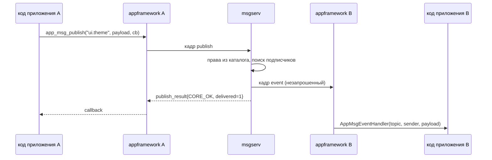

# brouk — брокер сообщений PUNos (`msgserv`)

## Что это

Системный сервис, через который **нативные приложения PUNos общаются друг с
другом**. Сейчас они не общаются никак.

```
приложение A ──publish──►  msgserv  ──event──►  приложение B
                              │                 приложение C
приложение A ──request──►     │     ──────────►  приложение D
приложение D ──respond──►     │     ──────────►  приложение A
```

`msgserv` — обычный userspace-процесс, как `logserv`. Ядро в обмене не
участвует: приложение пишет кадр в свой Unix-сокет, брокер читает его и пишет
кадр в сокет получателя. Endpoint — `/run/punos/msgserv.sock`.

**Статус: спецификация, кода нет.** Имя репозитория — `brouk`, имя сервиса —
`msgserv` по конвенции PUNos (`initserv`, `logserv`, `appserv`). Разрабатывается
отдельным репозиторием по образцу `appserv`/`initserv`/`logserv`: снапшот
`vendor/PUNos`, ревизия в `punos.ref`, свой CI, интеграция в PUNos — отдельным PR.

## Зачем

Единственный путь между двумя приложениями сегодня — попросить `appserv`
запустить или остановить другое приложение по `application_id`. Это плоскость
управления: передать данные нельзя (клиент не передаёт ни аргументы, ни
environment, ни данные приложения), обратного направления нет. Ни шины, ни
буфера обмена, ни intents в системе не существует.

## Два режима обмена

| Режим | Адрес | Кардинальность | Для чего |
| --- | --- | --- | --- |
| `publish` → `event` | `topic` | **многие-ко-многим** | события, уведомления |
| `request` → `response` | `instance_id` или `application_id` | 1:1 с корреляцией | запрос, которому нужен ответ |

Соединение `ipclib` — это `AF_UNIX`/`SOCK_STREAM`, то есть навсегда 1:1, и
менять это не нужно. Многие-ко-многим живёт в таблице подписок брокера: N
приложений держат N обычных соединений, один `publish` превращается в M
постановок кадра в M очередей. Трогать `ipclib` для этого не требуется.

## Как идёт сообщение



`appframework` — статическая библиотека внутри каждого приложения, не процесс.
Поэтому брокер её не «вызывает»: он пишет в уже открытое соединение, фреймворк
получателя видит `EVENT_READABLE` в своём event loop и вызывает callback.

Принципиально новое для `appframework`: кадры `event`, `deliver_request` и
`deliver_response` приходят **незапрошенными**, в любой момент — в том числе
между запросом приложения и ответом на него. Существующие клиенты `logserv`
и `appserv` только ждут ответ на свой запрос, такого режима в библиотеке нет.
Нужны два разных механизма: callback'и своих запросов и handler'ы входящих.

## Протокол v1

Один кадр `ipclib` на сообщение (заголовок 8 байт: `payload_size` u32,
`message_type` u32). Числа little-endian, строки UTF-8 без `NUL`, первое поле
каждого запроса — `u16 protocol_version` = 1. Все ответы содержат `ErrorCode`
из `libcore` как `u32`.

| Тип | Направление | Назначение |
| --- | --- | --- |
| `bind` / `bind_result` | клиент → сервис | Опознание по токену; в ответе — свои `instance_id` и `application_id` |
| `subscribe` / `unsubscribe` | клиент → сервис | Подписка на topic |
| `publish` / `publish_result` | клиент → сервис | Публикация; в ответе `delivered_count` и `dropped_count` |
| `event` | **сервис → клиент, незапрошенное** | Событие: отправитель, topic, `sequence`, payload |
| `request` / `request_result` | клиент → сервис | Адресный запрос; в ответе `correlation_id` от брокера |
| `deliver_request` | **сервис → клиент, незапрошенное** | Запрос адресату |
| `respond` / `respond_result` | клиент → сервис | Ответ по `correlation_id` |
| `deliver_response` | **сервис → клиент, незапрошенное** | Результат: транспортный `error` и прикладной `status` отдельно |
| `control.*` | `appserv` → сервис | Регистрация и освобождение экземпляров (6 типов) |

Поля отправителя в `event` и `deliver_request` заполняет **брокер**, их нет в
запросе — подделать отправителя невозможно.

### Лимиты

| Константа | Значение | Почему так |
| --- | --- | --- |
| `MSG_PAYLOAD_MAX_SIZE` | 65536 | 64 КиБ × 64 подписчика = 4 МиБ, то есть полный fan-out влезает в `IPC_OUTGOING_QUEUE_MAX_SIZE` |
| `MSG_QUEUE_MAX_RECORDS` / `_BYTES` | 1024 / 1 МиБ | Своя очередь получателя мягче очереди `ipclib`, чтобы отказ приходил от брокера, а не из транспорта |
| `MSG_CLIENTS_MAX` | 64 | Столько же, сколько записей в каталоге приложений |
| `MSG_TOPIC_MAX_LENGTH` | 128 | |
| `MSG_SUBSCRIPTIONS_MAX_PER_CLIENT` | 32 | Ограничивает работу на один `publish` |
| `MSG_PENDING_MAX_PER_CLIENT` | 256 | Как `APP_APPS_MAX_PENDING` |
| `MSG_REQUEST_TIMEOUT_MS` | 30000 | Предел жизни запроса без ответа |
| `MSG_BIND_TIMEOUT_MS` | 5000 | Как таймаут `logserv` в `initserv` |

Доставка — **at-most-once**, без персистентности и повторов: `CORE_OK` на
`publish` означает «принято в память брокера». При переполнении очереди
получателя кадр отбрасывается только для него, а его `sequence` по этому
topic'у всё равно увеличивается — разрыв в `sequence` и есть сигнал «я
пропустил события, надо перечитать состояние».

## Личность и права

Брокер не верит содержимому кадра: `ipclib` не даёт peer identity, и
спецификация `appserv` прямо поэтому называет свой endpoint «внутренним API
доверенных компонентов, а не публичным endpoint приложения».

Личность приходит токеном, который приложение не выбирает:

1. `initserv` создаёт `MsgControlToken` (32 байта, `random_fill`) и передаёт
   его `msgserv` и `appserv` в environment при запуске;
2. `appserv` открывает control-соединение с брокером этим токеном;
3. при каждом `app.launch` `appserv` генерирует `MessagingToken`, регистрирует
   пару «токен → (`application_id`, `instance_id`)» в брокере **до**
   `process_start` и передаёт токен ребёнку в environment;
4. приложение предъявляет токен в `bind` и получает свою подтверждённую
   личность. После bind `appserv` в обмене не участвует.

Это не новая машинерия: в GUI-ветке `ShellToken` уже передаётся
пользовательскому приложению-оболочке «защищённым handoff через `appserv`,
потому что shell является пользовательским приложением и не запускается
напрямую `initserv`». Задача идентична.

**Права — статические, из `PlatformRegistry`**, как каталог приложений
`NativeAppSpec`, и проверяются по общему `PlatformRegistryId`:

```json
"messaging": {
  "publish_topics":   ["ui.theme"],
  "subscribe_topics": ["sensor.gps", "app.state"],
  "serve_methods":    ["open_url"],
  "call_targets":     ["gallery"]
}
```

Нарушение — ошибка сборки, а не предупреждение. `publish` в topic, где у
подписчика нет права получать, не является ошибкой издателя: такой подписчик
просто не попадает в рассылку и не учитывается в счётчиках, иначе брокер стал
бы каналом утечки сведений о других приложениях.

## Что нужно исправить в PUNos

Ни одна правка не внесена — это предложения к согласованию с владельцами
компонентов. Строки — по ветке `main` на 28 октября 2026 года.

| Где | Что | Класс |
| --- | --- | --- |
| `appserv/src/service.c:123` | `instance_id` назначается **после** `process_start`, а регистрировать экземпляр в брокере нужно до запуска — иначе ребёнок сделает `bind` раньше, чем брокер узнает его токен. Перенести назначение выше | блокер |
| `appserv/src/service.c:103`, `src/main.c` | Генерация `MessagingToken`, control-клиент брокера (шаблон — готовый `AppLogger` в `src/logger.h`), добавление токена в environment ребёнка, `librandom` в `Makefile` | блокер |
| `appserv/src/service.c:201` | Отправлять `control.instance_release` при обнаружении завершения. Операция обязана быть идемпотентной: соединение рвётся сразу, а `process_poll` узнаёт о смерти до 1000 мс позже | блокер |
| `initserv` | `MsgControlToken`, запись `msgserv` в реестр, порядок `logserv` → **`msgserv`** → `appserv`, готовность по созданному endpoint'у | блокер |
| `appframework` | Модуль `messaging` и приём незапрошенных кадров; `app.h` | блокер |
| `PlatformRegistry` + оба генератора | Секция `messaging` **одним коммитом** в `appserv/tools/generate_catalog.py` и `initserv/tools/generate_registry.py`: если `PlatformRegistryId` разойдётся, не запустится ни один сервис | блокер |
| `appserv/src/service.c:4,68` | `struct AppInstance` не хранит создавшее соединение, `select_instance` ищет только по `id`. Сегодня `id` надо угадывать перебором, но брокер раздаёт настоящие `instance_id` всем подписчикам в поле `sender_instance_id` — и любое приложение сможет гасить любое другое | **дефект, который брокер делает опасным** |
| `appserv/src/service.c:201` | Завершённые экземпляры никогда не удаляются из списка: освобождение только в `app_service_shutdown`, предела числа нет. Брокер добавляет к каждому ещё запись в своей таблице | дефект |
| `ipclib`, `libprocess`, `constants.h` | `SO_PEERCRED` для сверки PID пира: обёртка `getsockopt` уже общая (`syscall.h:57`), но нет константы и нет способа узнать PID ребёнка (`libprocess` даёт только `process_current_id()`) | усиление, вне v1 |

Если правку про владельца экземпляра отложат, брокер **не должен** раздавать
`sender_instance_id` в событиях — адресация запросов останется только по
`application_id`.

## Тесты

Стиль — как в репозитории: freestanding-юниты на `testing/check.h` с
нумерованными `EXPECT`, инъекция отказов через `-Wl,--wrap=`, Python-интеграция
с настоящими процессами, мутационные проверки (мутация ломает одно правило
спецификации, тесты обязаны это заметить, ошибка сборки не считается).

| Уровень | Что проверяет |
| --- | --- |
| L1, юниты | Bind и отказ по токену; лимиты подписок, topic'ов, очередей; fan-out; `sequence` при отбрасывании; запрос/ответ, дедлайны, чужой `correlation_id`; очистка при закрытии соединения; идемпотентность `release` |
| L1, отказы | `memory_allocate`, `ipc_connection_send` (`CORE_WOULD_BLOCK` и жёсткая ошибка), `eventloop_wait`, `random_fill`; `ipc_message_destroy` ровно один раз |
| L2, протокол | Эталонные байты всех типов; усечения и лишние байты на каждом поле; невалидный UTF-8; неизвестный `message_type` → закрытие соединения; ~20 000 детерминированных порч кадров; **попытка подделать отправителя в `publish`** |
| L3, интеграция | Настоящие процессы и `logserv`; клиент, не читающий сокет, не тормозит брокера; 10 000 событий подряд; полный fan-out 64 КиБ × 64; `SIGKILL` клиента; перезапуск брокера; **в журнале нет ни токенов, ни payload** |
| L4, сквозные | Два и три приложения через `appframework`; ответ из таймера, а не из handler'а; работа без токена → `CORE_UNSUPPORTED`; восстановление подписок после перезапуска брокера; **событие, пришедшее между запросом и ответом, не путается с ответом** |
| L5, QEMU | Готовность `msgserv` до запуска `appserv`; `/init-smoke` с публикацией и приёмом внутри образа; воспроизводимость initramfs |

Правило: на каждый контракт спецификации — хотя бы один тест. Самые ценные
выделены жирным: это проверки того, что личность не берётся из payload, что
секреты не утекают в журнал и что новый режим незапрошенных кадров реализован
правильно.

## Порядок работ

Главное ограничение: **начинать код нельзя до мержа PR #9** «Базовый
графический стек» (+22 819 / −505, 118 файлов). Он меняет `ipclib`, `appserv`,
`initserv` и добавляет `librandom` с `random_fill()` — в `main` этой библиотеки
нет, то есть токены сгенерировать нечем. Спецификацию согласовывать можно
сразу.

1. **Согласовать развилки.** Фатален ли отказ `msgserv` при загрузке
   (предложение — нет, приложения получают `CORE_UNSUPPORTED`); отказывать ли
   `app.launch`, если регистрация в брокере не удалась (предложение — да);
   вносить ли в v1 привязку экземпляра к соединению; когда включать секцию
   `messaging` в `PlatformRegistryId`.
2. **Спецификация в PUNos**: `DevDoc/SystemServices/base/msgserv.md` и запись
   в `_ServList.md` — контракт живёт в PUNos, как у `logserv` и `initserv`,
   код остаётся здесь.
3. **Правки в PUNos** (после PR #9), отдельными PR в порядке: реестр и оба
   генератора → `initserv` → `appserv` → исправления дефектов.
4. **Скелет этого репозитория**: `Makefile`, `punos.ref`, `vendor/PUNos`, CI,
   генератор прав, жизненный цикл `Starting → Ready → Stopping` без протокола.
   Не зависит от п. 3.
5. **Протокол**: bind и control, затем весь L2. Самый важный этап для
   безопасности.
6. **Публикация и подписка** — первая точка, где брокер приносит пользу.
7. **Запрос и ответ**: `correlation_id`, дедлайны.
8. **Отказы, остановка, мутации.**
9. **Модуль `messaging` в `appframework`** — можно параллельно с пп. 5–8,
   против заглушки брокера.
10. **Интеграционный PR в PUNos**: сборка, initramfs, `/init-smoke`, CI.

## Чего нет в v1

Персистентность и durability; доставка незапущенному адресату и
launch-on-demand; передача дескрипторов и разделяемой памяти (`SCM_RIGHTS`
появляется в `ipclib` только в ветке GUI); wildcard-topic'и; фильтры по
содержимому; приоритеты; опрос состава topic'а; квоты по частоте; права на
уровне экземпляра, а не приложения; сетевой транспорт (`ipclib` только
`AF_UNIX`).

Чего эта модель не защищает, даже в полном виде: приложение с доступом к
своему environment может передать токен другому процессу в системе, а
`ipc_server_create()` по контракту `ipclib` безусловно делает `unlink()`
чужого endpoint'а, не проверяя, жив ли там сервер, — так что занять
`/run/punos/msgserv.sock` может кто угодно, слинковавший `ipclib`. Это
общесистемные упрощения v1, одинаково касающиеся `appserv` и `logserv`.
