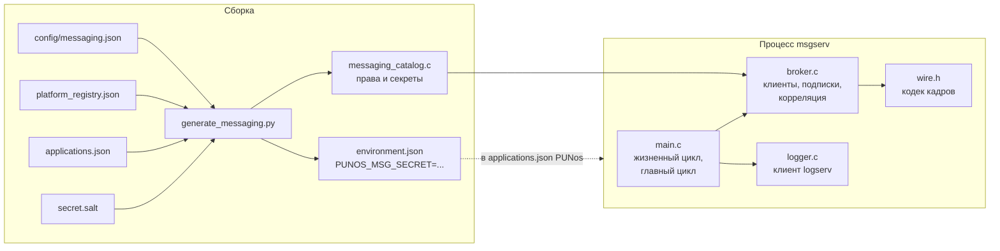
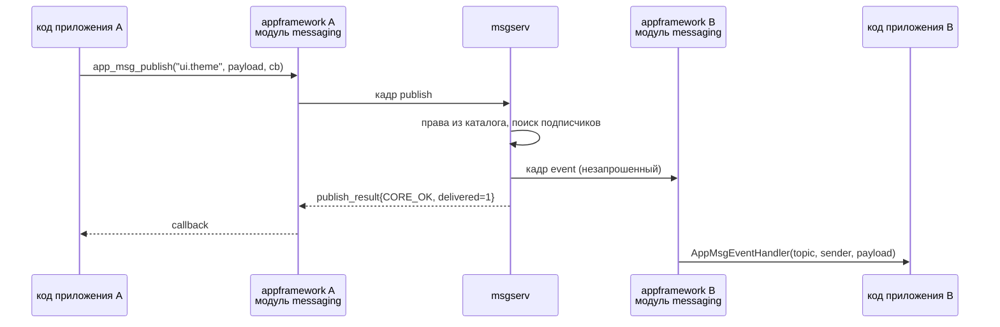

# brouk — брокер сообщений PUNos (`msgserv`)

## Что это

Системный сервис, через который **нативные приложения PUNos общаются друг с
другом**. Сейчас они не общаются никак.

```
приложение A ──publish──►  msgserv  ──event──►  приложение B
                              │                 приложение C
приложение A ──request──►     │     ──────────►  приложение D
приложение D ──respond──►     │     ──────────►  приложение A
```

`msgserv` — обычный userspace-процесс, как `logserv`. Ядро в обмене не
участвует: приложение пишет кадр в свой Unix-сокет, брокер читает его и пишет
кадр в сокет получателя. Endpoint — `/run/punos/msgserv.sock`.

**Статус.** Брокер реализован и проходит тесты L1-L3: работают `bind`,
подписки, рассылка, запрос-ответ с корреляцией и дедлайнами, лимиты,
журналирование и остановка по `SIGTERM`. Клиентская сторона — модуль
`messaging` в `appframework` — и спецификация сервиса
`DevDoc/SystemServices/base/msgserv.md` лежат в PUNos на ветке
`msgserv-integration`; модуль собирается и проходит свои runtime-тесты.
Открытые задачи — в issues этого репозитория.

Имя репозитория — `brouk`, имя сервиса — `msgserv` по конвенции PUNos
(`initserv`, `logserv`, `appserv`). Репозиторий самостоятельный, по образцу
`appserv`/`initserv`/`logserv`: снапшот `vendor/PUNos`, ревизия в `punos.ref`,
свой CI, интеграция в PUNos — отдельным PR.

## Зачем

Единственный путь между двумя приложениями сегодня — попросить `appserv`
запустить или остановить другое приложение по `application_id`. Это плоскость
управления: передать данные нельзя (клиент не передаёт ни аргументы, ни
environment, ни данные приложения), обратного направления нет. Ни шины, ни
буфера обмена, ни intents в системе не существует.

## Главное: ничего существующего не ломается

Брокер добавляется **данными в двух JSON-файлах плюс одна аддитивная правка в
`appframework`**: новый внутренний модуль и новые функции в `app.h`. Ни одной
изменённой сигнатуры, ни одного изменения поведения для приложений, которые
обменом не пользуются. В `appserv`, `initserv`, `ipclib` и в двух
существующих генераторах — ноль правок. Это следствие четырёх точек
расширения, которые в коде уже есть.

**1. Новый сервис в реестре запускается сам.** В
`initserv/tools/generate_registry.py:26` порядок задан словарём
`order = {'logserv':0,'appserv':1,'IOserv':2,'locationserv':3,'camserv':4}`, а
сортировка — `order.get(item['service_id'], 5)`: неизвестный `service_id`
получает 5 и запускается после известных. Схема записи фиксирована, но ничего
нового в ней не требуется. В `System/SystemServices/platform_registry.json`
добавляется одна запись:

```json
{ "service_id": "msgserv", "executable": "/punos/bin/msgserv",
  "arguments": [], "environment": [], "enabled": true,
  "critical": false, "restart": "restart", "terminates_on_sigterm": true }
```

`critical: false` — отказ брокера не рушит загрузку системы.

**2. `PlatformRegistryId` не разойдётся.** Он считается как
`sha256(json.dumps(registry, sort_keys=True, …))` от **всего файла реестра**, а
`generate_catalog.py` в `appserv` и `initserv` — байт-в-байт идентичные копии
одного скрипта. Реестр в PUNos один (`System/SystemServices/platform_registry.json`,
на него ссылаются оба `Makefile`), поэтому оба сервиса пересчитают один и тот
же новый хэш в одной сборке.

**3. Личность приложения выдаётся данными.** `environment` уже есть в схеме
`applications.json`, валидируется как `NAME=value`, попадает в
`NativeAppSpec.environment` и дальше в `ProcessLaunch` — существующим кодом
`appserv`. На `PlatformRegistryId` не влияет: хэшируется только
`platform_registry.json`, а не метаданные.

```json
{ "application_id": "gallery", "display_name": "Gallery",
  "executable": "/system/apps/gallery", "default_arguments": [],
  "environment": ["PUNOS_MSG_SECRET=9f2c…"], "terminates_on_sigterm": true }
```

**4. Клиент — модуль `messaging` в `appframework`, и он туда вписывается
аддитивно.** Рядом с существующими `applications` (клиент `appserv`) и
`logging` (клиент `logserv`) появляется седьмой модуль; `AppHandle` получает
третье клиентское соединение по той же схеме. Трогать существующий код не
нужно:

- `SPECIAL_DEPENDENCIES := ipclib` в `Makefile` уже покрывает модуль — новых
  зависимостей нет;
- `TEST_LDFLAGS` там же уже оборачивает `ipc_connection_finish_connect`,
  `ipc_connection_send` и `ipc_connection_flush` — то есть инфраструктура
  инъекции отказов, нужная модулю, готова;
- `AppRequestId` (монотонный, не переиспользуется, callback'и в порядке
  запросов), таблица pending-запросов, `app_log()`, отмена всего незавершённого
  в `app_destroy()` и обработчик `SIGTERM` — всё это уже есть и переиспользуется.

Альтернатива — отдельная клиентская библиотека, подключающая свой сокет через
публичную `app_event_add_fd()`, — рассматривалась и отвергнута: она завела бы
заново очередь, разбор кадров и обёртки отказов, и оставила бы две библиотеки,
которые надо держать в синхроне с протоколом.

Контракт при этом принадлежит **PUNos**: спецификация протокола —
`DevDoc/SystemServices/base/msgserv.md`, а константы `APP_MSG_*` и типы
клиента объявлены в публичном `appframework/app.h`. Этот репозиторий получает
их через закреплённую в `punos.ref` ревизию и обязан держать свои `MSG_*` из
`include/msgserv.h` равными им байт-в-байт.

| Ломающих правок | Аддитивных правок | Правок генераторов | Изменений данных | Зависимость от PR #9 |
| --- | --- | --- | --- | --- |
| **0** | 1 (`appframework`) | 0 | 2 файла | **нет** |

Зависимости от PR #9 «Базовый графический стек» (смержен в `main` 29 октября
2026) у брокера нет и не было: секреты генерируются при сборке скриптом этого
репозитория, а не `random_fill()` из `librandom`, который пришёл в `main`
вместе с тем PR.

Побочный выигрыш: брокер **не узнаёт и не раздаёт `AppInstanceId` из
`appserv`** — он нумерует клиентов сам. Поэтому и не возникает самая опасная
из возможных связок, когда `instance_id` из полученного события позволяет
остановить чужое приложение через `appserv`.

### Чем платим

- **Секрет запечён в образ** и меняется только пересборкой. Это главное
  ограничение подхода: если приложение однажды отдало свой секрет другому
  процессу, тот сможет представляться им всегда.
- **Личность подтверждается на уровне приложения, а не экземпляра.** Два
  экземпляра одного приложения запускаются и работают: оба подключаются, оба
  подписываются, оба публикуют — брокер различает их по собственному
  `client_id`, выданному при `bind`. Чего нельзя — подтвердить, какому именно
  запущенному `appserv`-экземпляру соответствует соединение. Для модели прав
  это безразлично: права заданы по `application_id` и у экземпляров одинаковы.
- **Приложение может открыть несколько соединений** под своим
  `application_id`, и запретить это нельзя — секрет действительно его. Угроза
  не в подделке, а в исчерпании `MSG_CLIENTS_MAX`, поэтому введён отдельный
  лимит `MSG_CONNECTIONS_MAX_PER_APPLICATION`.
- **`msgserv` стартует после `appserv`** (неизвестный `service_id` → порядок 5),
  поэтому модуль `messaging` обязан переподключаться с backoff'ом: приложение,
  запущенное сразу после загрузки, брокера ещё не найдёт.

## Сборка и запуск

Требования — те же, что у PUNos: Linux x86_64, `build-essential` (GCC 14),
`python3`, `git`. Эталонное окружение — `debian:trixie`; на другой платформе
соберётся только в контейнере, потому что сервис — freestanding ELF без libc.

```sh
make vendor    # снапшот PUNos в vendor/PUNos на ревизии из punos.ref
make all       # build/msgserv
make check     # генератор, L1, L2, отказы, L3
```

`make vendor` обязателен: заголовки, статические библиотеки и CRT берутся
только из снапшота, вкомпилированных копий в репозитории нет.

| Переменная | По умолчанию | Зачем менять |
| --- | --- | --- |
| `PUNOS_DIR` | `vendor/PUNos` | собрать против своего клона PUNos |
| `CONFIG` | `config/messaging.json` | другой набор прав |
| `REGISTRY` | `config/platform_registry.json` | проверить против реестра самого PUNos |
| `METADATA` | `config/applications.json` | другой каталог приложений |
| `SALT` | `secret.salt` | своя соль для секретов |

### Секреты

Секрет приложения выводится из солёного хэша его `application_id`:

```
secret = sha256(salt || 0x00 || application_id)
```

Соль лежит в `secret.salt`, в git не попадает и создаётся один раз:

```sh
make secret
```

Если файла нет, сборка создаёт его сама и говорит об этом. Одна и та же соль
даёт один и тот же образ, поэтому воспроизводимость initramfs не страдает;
новая соль обнуляет все ранее выданные секреты. Генератор заодно пишет
`build/generated/environment.json` — готовые записи `PUNOS_MSG_SECRET=...`
для `applications.json` в PUNos.

### Запуск

Аргументов у сервиса нет; endpoint задаётся на сборке:

```sh
cc ... -DMSG_ENDPOINT='"/run/punos/msgserv.sock"' -DMSG_LOG_ENDPOINT='"/run/punos/logserv.sock"'
```

В PUNos его запускает `initserv` по записи в `platform_registry.json`. Вне
образа сервис запускается как обычный процесс — так и работает L3-тест.

## Структура репозитория

| Путь | Что там |
| --- | --- |
| `include/msgserv.h` | протокол v1, лимиты, типы состояния брокера — единственный публичный заголовок |
| `src/broker.c` | вся логика: соединения, личность, подписки, рассылка, корреляция. Не знает про главный цикл |
| `src/wire.h` | кодек кадров: читатель с проверкой границ, писатель, сравнение секретов без ранних выходов |
| `src/logger.c`, `src/logger.h` | неблокирующий клиент `logserv` |
| `src/main.c` | жизненный цикл `Starting → Ready → Stopping` и главный цикл |
| `config/messaging.json` | права приложений — источник истины для генератора |
| `config/platform_registry.json`, `config/applications.json` | копии данных PUNos, чтобы репозиторий собирался до мержа интеграционного PR |
| `tools/generate_messaging.py` | генератор каталога прав и секретов |
| `tools/fetch_punos.py` | снапшот PUNos по `punos.ref` |
| `tests/` | L1, L2, отказы, L3 и тесты генератора |
| `config/messaging.sample.json` | пример прав с заполненными списками: сам каталог по умолчанию пуст |
| `.github/workflows/ci.yml` | сборка и все уровни тестов в `debian:trixie` |

Разделение `broker.c` / `main.c` не косметическое: юнит-тесты собирают
`broker.c` без `main.c` и подсовывают свой каталог и своё время, поэтому
дедлайны и таймауты проверяются без ожидания.



Один проход главного цикла: принять новые соединения → разобрать кадры каждого
готового соединения и поставить ответы и рассылку в очереди получателей →
истечь дедлайны → отдать непустые очереди в `ipclib`. Последний шаг отдельный
и обязательный: кадр, положенный в очередь чужим `publish`'ом или истёкшим
дедлайном, иначе лежал бы до следующего события на сокете получателя, которого
уровневый `epoll` не даст — читать там нечего, а запись брокер для этого
соединения ещё не запрашивал.

## Два режима обмена

| Режим | Адрес | Кардинальность | Для чего |
| --- | --- | --- | --- |
| `publish` → `event` | `topic` | **многие-ко-многим** | события, уведомления |
| `request` → `response` | `client_id` либо `application_id` | 1:1 с корреляцией | запрос, которому нужен ответ |

Надёжный адрес — `client_id` из поля отправителя полученного события: он
указывает на конкретное соединение. Адресация по `application_id` — удобство
для случая «подключён ровно один экземпляр»; при нескольких подключённых она
возвращает `CORE_ALREADY_EXISTS`, при нуле — `CORE_NOT_FOUND`. Так приложение
объявляет о себе публикацией в topic, а остальные берут его `client_id` оттуда.

Соединение `ipclib` — это `AF_UNIX`/`SOCK_STREAM`, то есть навсегда 1:1, и
менять это не нужно. Многие-ко-многим живёт в таблице подписок брокера: N
приложений держат N обычных соединений, один `publish` превращается в M
постановок кадра в M очередей.

## Как идёт сообщение



`appframework` — статическая библиотека внутри каждого приложения, не процесс.
Поэтому брокер её не «вызывает»: он пишет в уже открытое соединение, модуль
`messaging` получателя видит `EVENT_READABLE` в том же event loop'е, где живут
клиенты `logserv` и `appserv`, и вызывает обработчик приложения. Своих потоков
модуль не создаёт.

Принципиально новое для `appframework`: кадры `event`, `deliver_request` и
`deliver_response` приходят **незапрошенными**, в любой момент — в том числе
между запросом приложения и ответом на него. Существующие клиенты `logserv` и
`appserv` только ждут ответ на свой запрос, такого режима в библиотеке до
`messaging` не было. Поэтому модуль разделяет три механизма: callback'и своих
запросов (`AppMsgCallback`, как `AppAppsCallback`), обработчики входящих
кадров (`AppMsgEventHandler`, `AppMsgRequestHandler`,
`AppMsgResponseHandler`) и обработчик состояния связи (`AppMsgLinkHandler`).
Путать их нельзя: это самая вероятная ошибка использования модуля, и на неё
есть отдельный тест.

## Протокол v1

Один кадр `ipclib` на сообщение (заголовок 8 байт: `payload_size` u32,
`message_type` u32). Числа little-endian, строки UTF-8 без `NUL`, первое поле
каждого запроса — `u16 protocol_version` = 1. Все ответы содержат `ErrorCode`
из `libcore` как `u32`.

| Тип | Направление | Назначение |
| --- | --- | --- |
| `bind` / `bind_result` | клиент → сервис | `application_id` + секрет из environment; в ответе — подтверждённый `application_id` и `client_id`, выданный брокером |
| `subscribe` / `unsubscribe` | клиент → сервис | Подписка на topic |
| `publish` / `publish_result` | клиент → сервис | Публикация; в ответе `delivered_count` и `dropped_count` |
| `event` | **сервис → клиент, незапрошенное** | Событие: отправитель, topic, `sequence`, payload |
| `request` / `request_result` | клиент → сервис | Адресный запрос; в ответе `correlation_id` от брокера |
| `deliver_request` | **сервис → клиент, незапрошенное** | Запрос адресату |
| `respond` / `respond_result` | клиент → сервис | Ответ по `correlation_id` |
| `deliver_response` | **сервис → клиент, незапрошенное** | Результат: транспортный `error` и прикладной `status` отдельно |

Поля отправителя в `event` и `deliver_request` заполняет **брокер**, их нет в
запросе — подделать отправителя невозможно. На это есть отдельная проверка в
L2: кадр `publish`, в который клиент дописал `client_id` и чужой
`application_id`, отличается от корректного только лишними байтами — и
отвергается, а не принимается с чужой личностью.

### Номера и раскладка

Запрос клиента имеет нечётный тип, ответ на него — тип запроса плюс один, как
в протоколе `appserv`. Незапрошенные кадры лежат отдельным блоком от 20:
клиент обязан отличать их от ответа на свой запрос, и разрыв в нумерации
делает ошибку видимой.

| Тип | № | Поля после `u16 protocol_version` |
| --- | --- | --- |
| `bind` | 1 | `text application_id`, `text secret` |
| `bind_result` | 2 | `u32 error`, при `CORE_OK`: `text application_id`, `u64 client_id` |
| `subscribe` | 3 | `text topic` |
| `subscribe_result` | 4 | `u32 error` |
| `unsubscribe` | 5 | `text topic` |
| `unsubscribe_result` | 6 | `u32 error` |
| `publish` | 7 | `text topic`, `blob payload` |
| `publish_result` | 8 | `u32 error`, при `CORE_OK`: `u16 delivered_count`, `u16 dropped_count` |
| `request` | 9 | `u8 target_kind`, при 0: `u64 client_id`, при 1: `text application_id`; затем `text method`, `blob payload` |
| `request_result` | 10 | `u32 error`, при `CORE_OK`: `u64 correlation_id` |
| `respond` | 11 | `u64 correlation_id`, `u32 status`, `blob payload` |
| `respond_result` | 12 | `u32 error` |
| `event` | 20 | `u64 sender_client_id`, `text sender_application_id`, `text topic`, `u64 sequence`, `blob payload` |
| `deliver_request` | 21 | `u64 correlation_id`, `u64 sender_client_id`, `text sender_application_id`, `text method`, `blob payload` |
| `deliver_response` | 22 | `u64 correlation_id`, `u32 error`, `u32 status`, `blob payload` |

`text` — `u16` длины и байты UTF-8 без `NUL`; `blob` — `u32` длины и
произвольные байты. У незапрошенных кадров `protocol_version` нет: их шлёт
брокер, версию уже согласовали при `bind`.

Любое отклонение — усечение, лишний байт, невалидный UTF-8, неизвестный
`message_type`, версия не 1, запрос до `bind` — закрывает соединение. Брокер
не отвечает на кадр, который не разобрал: ответ подразумевал бы, что он понял
запрос.

### Коды ошибок

| Ответ | Код | Когда |
| --- | --- | --- |
| `bind_result` | `CORE_NOT_FOUND` | такого `application_id` нет в каталоге |
| | `CORE_PERMISSION_DENIED` | секрет не совпал |
| | `CORE_OVERFLOW` | заняты все `MSG_CONNECTIONS_MAX_PER_APPLICATION` |
| | `CORE_INVALID_STATE` | соединение уже прошло `bind` |
| `subscribe_result` | `CORE_PERMISSION_DENIED` | topic'а нет в `subscribe_topics` |
| | `CORE_ALREADY_EXISTS` | подписка уже есть |
| | `CORE_OVERFLOW` | упор в `MSG_SUBSCRIPTIONS_MAX_PER_CLIENT` |
| `publish_result` | `CORE_PERMISSION_DENIED` | topic'а нет в `publish_topics` |
| `request_result` | `CORE_NOT_FOUND` | нет такого `client_id` либо ни одного экземпляра приложения |
| | `CORE_ALREADY_EXISTS` | подключено несколько экземпляров адресата |
| | `CORE_PERMISSION_DENIED` | адресата нет в `call_targets` либо метода нет в его `serve_methods` |
| | `CORE_WOULD_BLOCK` | очередь адресата полна либо упор в `MSG_PENDING_MAX_PER_CLIENT` |
| `respond_result` | `CORE_NOT_FOUND` | такого `correlation_id` нет |
| | `CORE_PERMISSION_DENIED` | `correlation_id` чужой: запрос доставлен не этому соединению |
| `deliver_response` | `CORE_TIMEOUT` | ответ не пришёл за `MSG_REQUEST_TIMEOUT_MS` |
| | `CORE_NOT_FOUND` | адресат отключился, не ответив |

В отказе `bind_result` нет ни `client_id`, ни подтверждённого
`application_id`, а «нет такого приложения» и «не тот секрет» не различаются в
журнале — иначе брокер подсказывал бы подбирающему.

### Лимиты

| Константа | Значение | Почему так |
| --- | --- | --- |
| `MSG_PAYLOAD_MAX_SIZE` | 65536 | 64 КиБ × 64 подписчика = 4 МиБ, то есть полный fan-out влезает в `IPC_OUTGOING_QUEUE_MAX_SIZE` |
| `MSG_QUEUE_MAX_RECORDS` / `_BYTES` | 1024 / 1 МиБ | Своя очередь получателя мягче очереди `ipclib`, чтобы отказ приходил от брокера, а не из транспорта |
| `MSG_CLIENTS_MAX` | 64 | Столько же, сколько записей в каталоге приложений |
| `MSG_CONNECTIONS_MAX_PER_APPLICATION` | 4 | Секрет один на приложение, поэтому число его соединений ограничивается явно — иначе одно приложение займёт все слоты |
| `MSG_TOPIC_MAX_LENGTH` | 128 | |
| `MSG_SUBSCRIPTIONS_MAX_PER_CLIENT` | 32 | Ограничивает работу на один `publish` |
| `MSG_PENDING_MAX_PER_CLIENT` | 256 | Как `APP_APPS_MAX_PENDING` |
| `MSG_REQUEST_TIMEOUT_MS` | 30000 | Предел жизни запроса без ответа |
| `MSG_BIND_TIMEOUT_MS` | 5000 | Как таймаут `logserv` в `initserv` |

Доставка — **at-most-once**, без персистентности и повторов: `CORE_OK` на
`publish` означает «принято в память брокера». При переполнении очереди
получателя кадр отбрасывается только для него, а его `sequence` по этому
topic'у всё равно увеличивается — разрыв в `sequence` и есть сигнал «я
пропустил события, надо перечитать состояние».

## Права

Брокер не верит содержимому кадра: `ipclib` не даёт peer identity, и
спецификация `appserv` прямо поэтому называет свой endpoint «внутренним API
доверенных компонентов, а не публичным endpoint приложения». Приложение
доказывает, кто он, секретом из своего environment; `application_id` без
совпавшего секрета отклоняется.

Права — статические, в **своём файле этого репозитория** (`config/messaging.json`),
а не в `PlatformRegistry`: так не нужно трогать ни схему реестра, ни два
существующих генератора. Генератор брокера читает этот файл вместе с копией
реестра и проверяет, что все `application_id` в нём существуют.

```json
"gallery": {
  "publish_topics":   ["app.state"],
  "subscribe_topics": ["ui.theme", "sensor.gps"],
  "serve_methods":    ["open_image"],
  "call_targets":     ["settings"]
}
```

Нарушение — ошибка сборки, а не предупреждение. `publish` в topic, где у
подписчика нет права получать, не является ошибкой издателя: такой подписчик
просто не попадает в рассылку и не учитывается в счётчиках, иначе брокер стал
бы каналом утечки сведений о других приложениях.

## Тесты

Стиль — как в PUNos: freestanding-юниты на `testing/check.h` с нумерованными
`EXPECT`, инъекция отказов через `-Wl,--wrap=` в отдельно слинкованных
программах, Python-интеграция с настоящими процессами.

| Уровень | Файл | Что проверяет |
| --- | --- | --- |
| Генератор | `tests/test_generator.py` | каждое правило прав — ошибка сборки, а не предупреждение; детерминированность от соли; порядок приложений в JSON на вывод не влияет; копия реестра расходится со снапшотом ровно записью `msgserv` |
| L1, логика | `tests/broker_test.c` | `bind` и три вида отказа; лимиты соединений на приложение, клиентов, подписок; два экземпляра различаются по `client_id`; fan-out и `sequence`; переполнение очереди и разрыв в `sequence`; запрос/ответ, адресация по `application_id` при нуле и при нескольких; чужой `correlation_id`; дедлайн; обрыв адресата; таймаут `bind`; очистка при закрытии |
| L1, отказы | `tests/fault_test.c` | `memory_allocate` отказывает по очереди в каждом вызове прохода — брокер остаётся работоспособным; `ipc_connection_send` с `CORE_OVERFLOW` (кадр ждёт в своей очереди и доезжает) и с жёсткой ошибкой (падает одно соединение); `ipc_connection_flush`; `ipc_message_destroy` ровно один раз на принятый кадр |
| L2, протокол | `tests/protocol_test.c` | эталонные байты всех типов; все усечения и лишний байт на каждом кадре; невалидный UTF-8 и `NUL`; `payload` на единицу больше предела и ровно предел; запрещённые `message_type`; 2048 детерминированных порч; **попытка подделать отправителя в `publish`** |
| L3, интеграция | `tests/integration.py` | настоящий процесс и тестовый `logserv`; клиент, не читающий сокет, не тормозит брокера; 10 000 событий подряд без разрывов; полный fan-out 64 КиБ на 63 подписчика; обрыв адресата; отказ 65-го соединения; остановка по `SIGTERM` и перезапуск; **в журнале нет ни секретов, ни payload** |

Правило: на каждый контракт спецификации — хотя бы один тест. Выделенные
жирным — проверки того, что личность не берётся из payload, что секреты не
утекают в журнал и что режим незапрошенных кадров реализован правильно.

Детерминированные порчи в L2 берут корректный кадр каждого типа, меняют в нём
один байт и требуют одного: брокер либо отвечает кодом ошибки, либо закрывает
соединение, и после этого продолжает правильно обслуживать следующего
клиента. Последовательность порч задаёт xorshift с зашитым начальным
состоянием, поэтому прогон воспроизводим на любой машине.

Отдельно о L1-отказах: там проверяется не конкретный номер неудачной
аллокации — он зависит от внутренностей `ipclib` и поехал бы при обновлении
`punos.ref`, — а инвариант «какой бы вызов в проходе брокера ни отказал,
брокер остаётся живым». Поэтому отказ переставляется по всем вызовам прохода
подряд.

## Решения, принятые по дороге

Права живут в `config/messaging.json` этого репозитория, а не в
`PlatformRegistry`: так не нужно трогать ни схему реестра, ни два
существующих генератора. Личность подтверждается на уровне приложения, а не
экземпляра.

Чего в v1 нет сознательно — персистентность, launch-on-demand, передача
дескрипторов, wildcard-topic'и, приоритеты, квоты и сетевой транспорт —
перечислено в спецификации сервиса, раздел «Ограничения версии»
(`DevDoc/SystemServices/base/msgserv.md` в PUNos).
