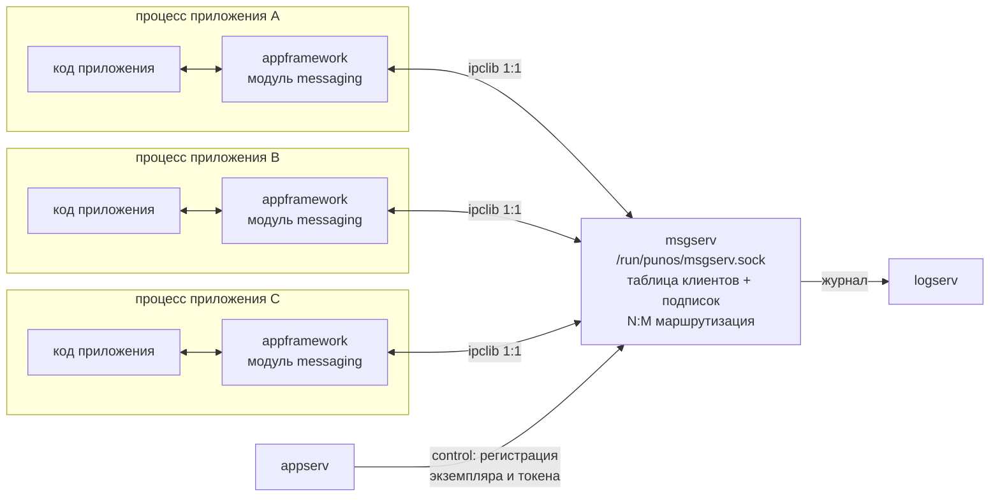

# brouk — брокер сообщений PUNos (`msgserv`)

Проектная документация системного сервиса **`msgserv`** — брокера сообщений
для [PUNos](https://github.com/ITMOdefence/PUNos), который даёт нативным
приложениям связь **многие-ко-многим** вместо единственной существующей схемы
«приложение → системный сервис».

`brouk` — имя репозитория. Сам сервис называется `msgserv` по конвенции PUNos
(`initserv`, `logserv`, `appserv`, `IOserv`), его endpoint —
`/run/punos/msgserv.sock`.

> **Статус: спецификация, кода нет.** В PUNos принято правило «документация
> в `DevDoc/` является контрактом, реализация обязана ему соответствовать».
> Сейчас здесь черновик такого контракта: его нужно обсудить до изменения
> спецификаций в `PUNos/DevDoc/`. Порядок переноса описан в
> [`docs/roadmap.md`](docs/roadmap.md).

`brouk` — **отдельный репозиторий модуля**, по той же модели, что `appserv`,
`initserv` и `logserv`: реализация живёт здесь вместе со снапшотом
`vendor/PUNos` и закреплённой ревизией в `punos.ref`, CI собирает модуль без
доступа к приватному upstream, а интеграция в PUNos предлагается отдельным PR.
Контракт при этом дублируется в PUNos (`DevDoc/SystemServices/base/msgserv.md`)
— ровно так, как это сделано для трёх существующих сервисов. Планируемая
структура репозитория — в
[`docs/roadmap.md`](docs/roadmap.md#2-структура-репозитория).

## Зачем

Сейчас два приложения PUNos не взаимодействуют никак. Единственный путь между
ними — попросить `appserv` запустить или остановить другое приложение по
`application_id`: это плоскость управления, по ней нельзя передать данные
(`appserv` по контракту не принимает от клиента ни аргументы, ни environment,
ни данные приложения) и у неё нет обратного направления. Ни шины, ни буфера
обмена, ни intents в системе нет.

`msgserv` добавляет недостающий слой: публикацию событий по topic'ам
(многие-ко-многим) и адресные запросы с ответом (один-к-одному) между
приложениями, с правами, выданными на этапе сборки, и с опознанием
отправителя, которому приложение не может соврать.

## Как читать

| Документ | О чём |
| --- | --- |
| [`docs/architecture.md`](docs/architecture.md) | Топология, почему брокер, а не прямые соединения; как из 1:1-соединений `ipclib` получается N:M; все схемы |
| [`docs/msgserv.md`](docs/msgserv.md) | Спецификация сервиса в формате `PUNos/DevDoc`: ответственность, границы, зависимости, жизненный цикл, состояния, владение ресурсами, контракты, лимиты |
| [`docs/wire-protocol.md`](docs/wire-protocol.md) | Протокол v1: типы сообщений, байтовая раскладка payload, коды ошибок, последовательности обмена |
| [`docs/identity-and-permissions.md`](docs/identity-and-permissions.md) | Опознание отправителя (`MessagingToken`), handoff через `appserv`, права из `PlatformRegistry` на этапе сборки |
| [`docs/appframework-messaging.md`](docs/appframework-messaging.md) | Публичный API для приложения: модуль `messaging` в `appframework`, `app.h` |
| [`docs/upstream-changes.md`](docs/upstream-changes.md) | **Что нужно исправить в существующем коде PUNos** — с путями, строками и причинами |
| [`docs/testing.md`](docs/testing.md) | Набор тестов: freestanding-юниты, инъекция отказов, Linux-интеграция, мутационные проверки, QEMU |
| [`docs/roadmap.md`](docs/roadmap.md) | Порядок работ по этапам, зависимости между ними, границы v1 |

Начинать стоит с [`docs/architecture.md`](docs/architecture.md), затем
[`docs/upstream-changes.md`](docs/upstream-changes.md) — он показывает реальную
цену решения.

## Схема в двух словах

`appframework` — не процесс, а статическая библиотека внутри каждого
приложения, поэтому брокер не «вызывает фреймворк»: он пишет кадр в уже
открытое соединение, фреймворк получателя видит `EVENT_READABLE` в своём event
loop и вызывает callback приложения.

## Что в v1 сознательно не входит

Персистентность и durability, доставка offline-адресату, запуск адресата по
требованию (launch-on-demand), передача дескрипторов и разделяемой памяти,
приоритеты, фильтры по содержимому, wildcard-topic'и, сетевой транспорт,
установка прав во время работы. Обоснование каждого отказа —
в [`docs/msgserv.md`](docs/msgserv.md#границы-v1), планы —
в [`docs/roadmap.md`](docs/roadmap.md#после-v1).

## Соглашения

Документация и спецификации — на русском, код, комментарии в коде и README
компонентов — на английском: так принято в PUNos. Все числа в payload
little-endian, строки — UTF-8 без `NUL`, все операции возвращают `ErrorCode`
из `libcore`, `CORE_OK` — единственный успешный результат.
