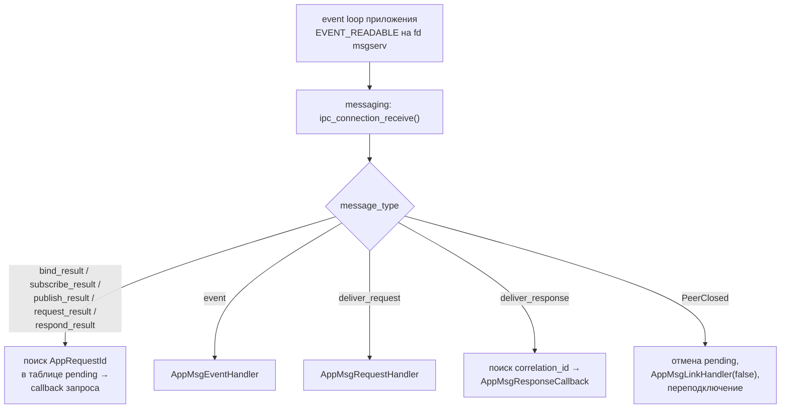
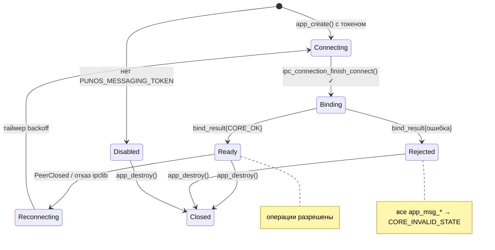

# appframework: модуль `messaging`

## 1. Место в библиотеке

`appframework` — статическая библиотека `libappframework.a` внутри каждого
приложения. Сейчас у неё шесть внутренних модулей: `application`, `runtime`,
`eventloop`, `applications` (клиент `appserv`), `logging` (клиент `logserv`),
`lifecycle`. Брокер добавляет седьмой — **`messaging`**, клиент `msgserv`.

| Модуль | Ответственность |
| --- | --- |
| `messaging` | Соединение с `msgserv`, bind, подписки, публикация, запросы и ответы, доставка незапрошенных кадров приложению, переподключение |

Модуль — часть той же библиотеки, а не самостоятельная публичная библиотека,
как и остальные шесть.

## 2. Что в модуле принципиально нового

Существующие клиенты `applications` и `logging` работают по одной схеме:
отправили запрос — получили ответ **на свой же** запрос, callback'и приходят в
порядке запросов. Брокер ломает эту симметрию: кадры `event`,
`deliver_request` и `deliver_response` приходят **незапрошенными**, в любой
момент, в том числе между запросом приложения и ответом на него.

Поэтому модуль вводит разделение, которого в `appframework` не было:

| Вид обратного вызова | Когда срабатывает | Аналог в текущем коде |
| --- | --- | --- |
| **Callback запроса** (`AppMsgCallback`, `AppMsgResponseCallback`) | На ответ на собственный запрос приложения | `AppAppsCallback` |
| **Handler** (`AppMsgEventHandler`, `AppMsgRequestHandler`, `AppMsgLinkHandler`) | На незапрошенное входящее событие | нет аналога |



## 3. Публичный API

Добавляется в существующий `appframework/app.h`. Стиль полностью повторяет
имеющийся: непрозрачный `AppHandle`, `ErrorCode` на возврат, `out_`-параметры,
валидные только при `CORE_OK`, строки — NUL-terminated UTF-8.

### Константы

```c
/* Longest topic, in bytes (msgserv IPC contract). */
#define APP_MSG_TOPIC_MAX_LENGTH ((usize)128)
/* Longest method name, in bytes. */
#define APP_MSG_METHOD_MAX_LENGTH ((usize)64)
/* Largest message payload, in bytes. */
#define APP_MSG_PAYLOAD_MAX_SIZE ((usize)65536)
/* Requests to msgserv that may wait for an answer at the same time. */
#define APP_MSG_MAX_PENDING ((usize)256)
/* Topics one application may be subscribed to at the same time. */
#define APP_MSG_MAX_SUBSCRIPTIONS ((usize)32)
/* Version of the msgserv protocol that framework speaks. */
#define APP_MSG_PROTOCOL_VERSION ((u16)1)
```

### Типы

```c
/* Non-zero identifier of one request in flight through msgserv. Not reused. */
typedef u64 AppMsgCorrelationId;

/* Identity of the peer, filled in by msgserv. Valid during the callback. */
typedef struct AppMsgSender {
    AppInstanceId instance;
    const char *application_id;
} AppMsgSender;

/* One published event. All members are valid only during the handler. */
typedef struct AppMsgEvent {
    AppMsgSender sender;
    const char *topic;
    u64 sequence;   /* monotonic per topic; a gap means events were dropped */
    Bytes payload;
} AppMsgEvent;

/* One incoming request that this application must answer. */
typedef struct AppMsgRequest {
    AppMsgCorrelationId correlation;
    AppMsgSender sender;
    const char *method;
    Bytes payload;
} AppMsgRequest;

/* Answer to a request this application sent. */
typedef struct AppMsgResponse {
    AppMsgCorrelationId correlation;
    ErrorCode status;   /* the peer application's own result */
    Bytes payload;
} AppMsgResponse;

/* Result of app_msg_publish(): how many subscribers took the event. */
typedef struct AppMsgPublishResult {
    u16 delivered_count;
    u16 dropped_count;
} AppMsgPublishResult;
```

### Обработчики незапрошенных кадров

```c
/* Called on the owner thread from app_run(). event is valid only during the
 * call; copy what must outlive it. */
typedef void (*AppMsgEventHandler)(AppHandle app, const AppMsgEvent *event,
                                   void *context);

/* The application must answer with app_msg_respond(), from this handler or
 * later. An unanswered request is closed by msgserv on its deadline. */
typedef void (*AppMsgRequestHandler)(AppHandle app, const AppMsgRequest *request,
                                     void *context);

/* connected == false: the link to msgserv is lost, subscriptions and pending
 * requests are gone. connected == true: bind and every subscription have been
 * restored by the framework. */
typedef void (*AppMsgLinkHandler)(AppHandle app, bool connected, void *context);

ErrorCode app_msg_set_event_handler(AppHandle app, AppMsgEventHandler handler,
                                    void *context);
ErrorCode app_msg_set_request_handler(AppHandle app, AppMsgRequestHandler handler,
                                      void *context);
ErrorCode app_msg_set_link_handler(AppHandle app, AppMsgLinkHandler handler,
                                   void *context);
```

### Операции

```c
/* Own identity as confirmed by msgserv at bind. Both out params are optional;
 * the string stays valid while the AppHandle exists. */
ErrorCode app_msg_identity(AppHandle app, AppInstanceId *out_instance,
                           const char **out_application_id);

/* Callback of a request this application sent to msgserv. result is NULL
 * unless error is CORE_OK. */
typedef void (*AppMsgCallback)(AppHandle app, AppRequestId request,
                               ErrorCode error,
                               const AppMsgPublishResult *result, void *context);

ErrorCode app_msg_subscribe(AppHandle app, const char *topic,
                            AppMsgCallback callback, void *context,
                            AppRequestId *out_request);
ErrorCode app_msg_unsubscribe(AppHandle app, const char *topic,
                              AppMsgCallback callback, void *context,
                              AppRequestId *out_request);
ErrorCode app_msg_publish(AppHandle app, const char *topic, Bytes payload,
                          AppMsgCallback callback, void *context,
                          AppRequestId *out_request);

/* Called once per accepted request, when msgserv closes it: with the peer's
 * answer (CORE_OK), or CORE_TIMEOUT / CORE_NOT_FOUND / CORE_INVALID_STATE. */
typedef void (*AppMsgResponseCallback)(AppHandle app, AppRequestId request,
                                       ErrorCode error,
                                       const AppMsgResponse *response,
                                       void *context);

ErrorCode app_msg_request_instance(AppHandle app, AppInstanceId target,
                                   const char *method, Bytes payload,
                                   AppMsgResponseCallback callback,
                                   void *context, AppRequestId *out_request);
ErrorCode app_msg_request_application(AppHandle app, const char *application_id,
                                      const char *method, Bytes payload,
                                      AppMsgResponseCallback callback,
                                      void *context, AppRequestId *out_request);

/* Answers an incoming request. status is this application's own result. */
ErrorCode app_msg_respond(AppHandle app, AppMsgCorrelationId correlation,
                          ErrorCode status, Bytes payload);
```

## 4. Контракты модуля

1. Все операции выполняются на потоке-владельце, который вызвал `app_create()`
   — как и всё в `appframework`, кроме `app_request_quit()`.
2. Соединение с `msgserv` устанавливается в `app_create()`, если в environment
   есть `PUNOS_MESSAGING_TOKEN`. Подключение неблокирующее: `app_create()` не
   ждёт ни `connect`, ни `bind_result`.
3. Если токена в environment нет, все `app_msg_*` возвращают
   `CORE_UNSUPPORTED`. Это штатная ситуация: приложение может быть не
   зарегистрировано в обмене, и падать из-за этого оно не должно.
4. Операции, вызванные до завершения bind, принимаются и отправляются после
   него. Отказ bind переводит модуль в состояние, где все операции возвращают
   `CORE_INVALID_STATE`, и однократно вызывает `AppMsgLinkHandler(false)`.
5. `CORE_OK` на возврате `app_msg_*` означает «запрос поставлен в очередь»,
   а не «выполнен». Результат приходит в callback.
6. Callback'и запросов вызываются ровно один раз каждый, в порядке запросов,
   и никогда до того, как вызвавшая их функция вернула `CORE_OK` — та же
   гарантия, что у `AppAppsCallback`.
7. `payload`, переданный в `app_msg_publish()`, `app_msg_request_*()` и
   `app_msg_respond()`, копируется до возврата из функции. Владение исходным
   `Bytes` остаётся у приложения.
8. `AppMsgEvent`, `AppMsgRequest` и `AppMsgResponse` валидны только во время
   вызова обработчика. Память освобождает фреймворк; приложение копирует то,
   что должно пережить вызов.
9. `AppMsgRequestHandler` не установлен, а `deliver_request` пришёл — фреймворк
   сам отвечает `CORE_UNSUPPORTED` и журналирует `WARNING`. Молча терять
   запрос нельзя: отправитель будет ждать до `MSG_REQUEST_TIMEOUT_MS`.
10. `app_msg_respond()` можно вызвать из обработчика или позже — например,
    после завершения собственной асинхронной работы. Повторный ответ на тот же
    `correlation` возвращает `CORE_NOT_FOUND`.
11. Разрыв в `sequence` события — не ошибка, а сигнал потери. Фреймворк его не
    скрывает и не пытается восстановить: это решение приложения.
12. `app_destroy()` завершает все pending-запросы с `CORE_INVALID_STATE`,
    закрывает соединение (с предварительным `ipc_connection_flush()`, как
    требует контракт 15 `ipclib`) и освобождает буферы модуля.
13. Модуль не создаёт ни потоков, ни процессов, ни собственного event loop'а:
    он регистрирует невладеющий fd соединения в event loop'е `AppHandle`.

## 5. Переподключение

Это ответственность фреймворка, а не приложения. При `PeerClosed` или отказе
соединения модуль:

1. отменяет все pending-запросы, вызывая их callback'и с `CORE_INVALID_STATE`;
2. вызывает `AppMsgLinkHandler(false)`;
3. переподключается с backoff'ом 1000, 2000, 4000, 8000, 16000, 30000 мс с
   потолком 30000 — те же задержки, что у перезапусков в `initserv`, чтобы
   поведение системы было единообразным;
4. после успешного bind **восстанавливает все подписки**, которые приложение
   успешно оформило ранее, в порядке их оформления;
5. вызывает `AppMsgLinkHandler(true)`.



Токен переживает перезапуск брокера (startup-токены живут до конца загрузочной
сессии), поэтому повторный bind тем же токеном корректен и ожидаем.

Чего фреймворк **не** восстанавливает: pending-запросы. Повторить запрос может
только приложение — фреймворк не знает, идемпотентен ли он.

## 6. Пример использования

```c
#include <appframework/app.h>

static AppHandle app;

static void on_event(AppHandle a, const AppMsgEvent *event, void *context)
{
    (void)a; (void)context;
    app_log(app, APP_LOG_LEVEL_INFO, "event received");
    /* event->payload валиден только здесь */
}

static void on_request(AppHandle a, const AppMsgRequest *request, void *context)
{
    (void)context;
    Bytes answer = { .data = NULL, .size = 0 };
    (void)app_msg_respond(a, request->correlation, CORE_OK, answer);
}

static void on_subscribed(AppHandle a, AppRequestId id, ErrorCode error,
                          const AppMsgPublishResult *result, void *context)
{
    (void)a; (void)id; (void)result; (void)context;
    if (error != CORE_OK)
        app_log(app, APP_LOG_LEVEL_ERROR, "subscribe failed");
}

int main(void)
{
    AppConfig config = { .application_id = "gallery", .log_component = "gallery" };
    AppRequestId request;

    if (app_create(&config, &app) != CORE_OK) return 1;
    (void)app_msg_set_event_handler(app, on_event, NULL);
    (void)app_msg_set_request_handler(app, on_request, NULL);
    (void)app_msg_subscribe(app, "ui.theme", on_subscribed, NULL, &request);

    (void)app_run(app);
    (void)app_destroy(&app);
    return 0;
}
```

## 7. Сборка

В `System/ApplicationLayer/appframework/Makefile` ничего не добавляется в
зависимости: `SPECIAL_DEPENDENCIES := ipclib` уже покрывает модуль, потому что
`msgserv` — такой же IPC-сервис, как `logserv` и `appserv`. Новых System Libs
модулю тоже не нужно: `libmem`, `libstr`, `libeventloop` и `libcore` уже
подключены.

Нужно другое — добавить `msgserv` в список сервисов для сквозных тестов
уровня 3 (сейчас там «appframework with real logserv and appserv»), см.
[`testing.md`](testing.md#l3--сквозные-тесты-с-настоящими-сервисами).
