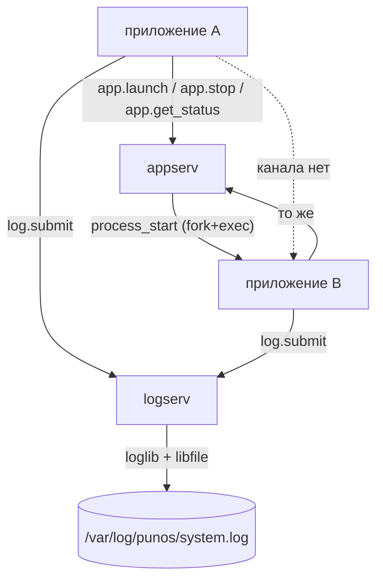
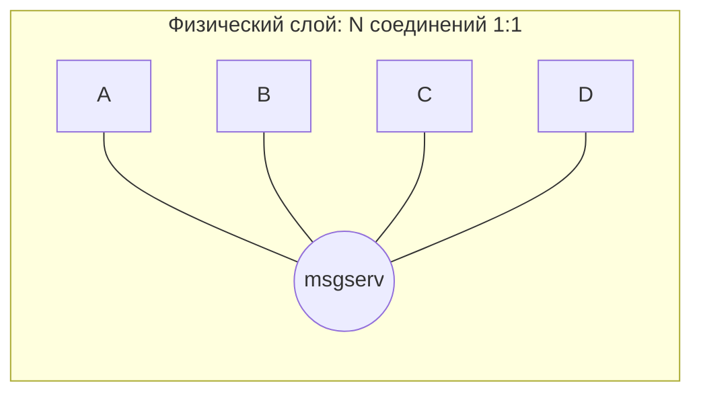
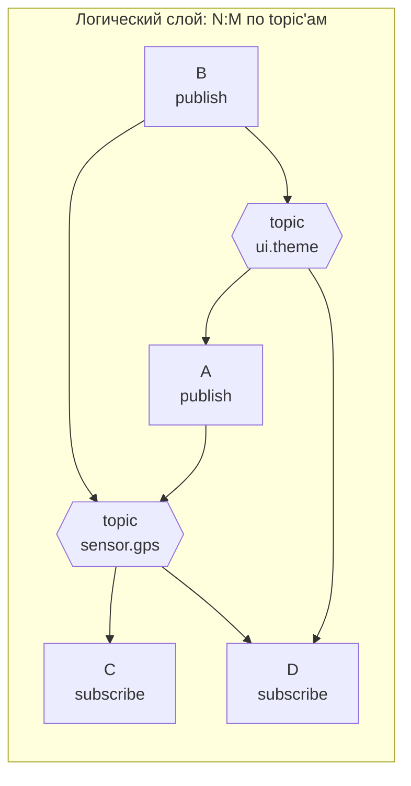
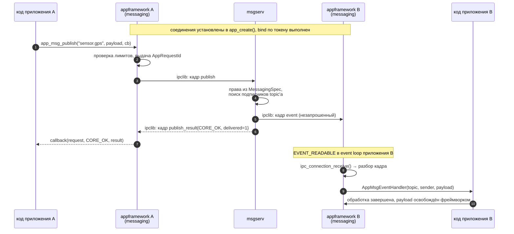
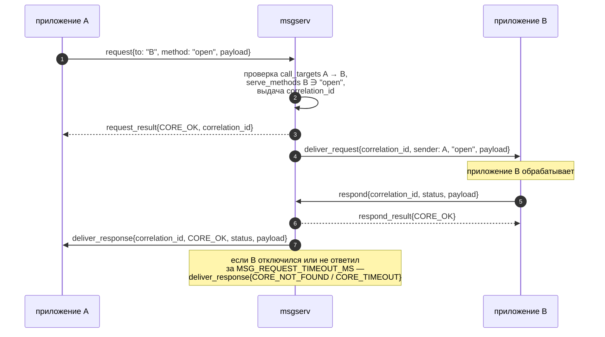
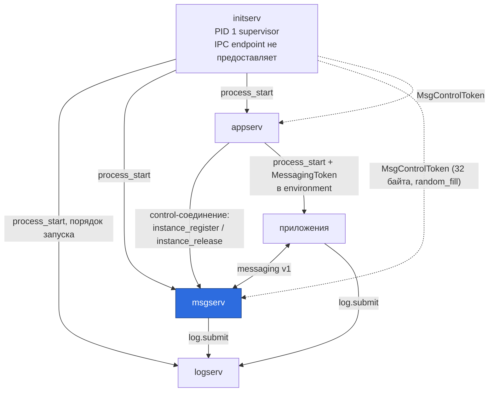
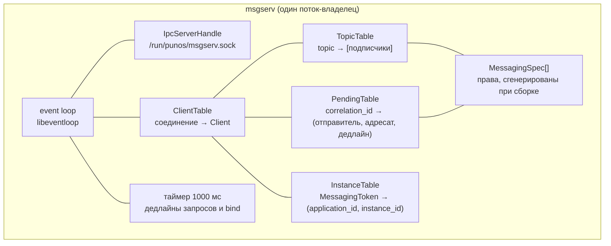
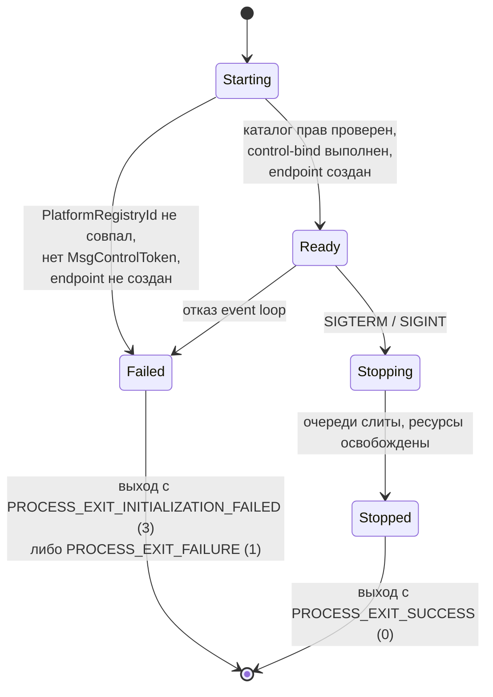
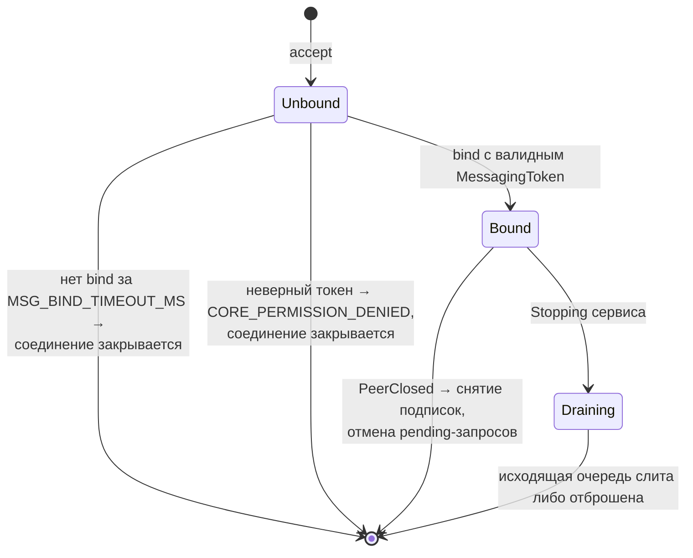
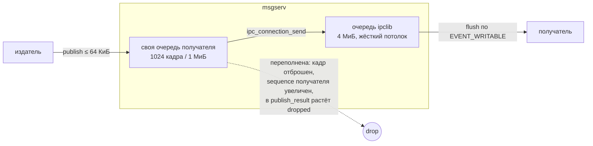

# Архитектура брокера сообщений

## 1. Что есть сейчас

В PUNos приложение является только IPC-**клиентом**. `appframework` создаёт
`AppHandle`, владеет event loop'ом и держит два неблокирующих клиентских
соединения — к `logserv` и к `appserv`. Своего endpoint'а у приложения нет,
спецификация `appframework` фиксирует это прямо: «IPC endpoint — отсутствует».
Приложение невозможно позвать.

Единственная связь A → B — попросить `appserv` запустить или остановить B.
Это управление, не данные: клиент не передаёт ни путь к ELF, ни аргументы, ни
environment, ни данные приложения (контракт 2 спецификации `appserv`), а
`appserv` «не получает и не интерпретирует данные, которые приложение
использует после запуска» (контракт 10). Обратного направления нет: B не
знает, кто его запустил.

## 2. Три возможных решения и выбор

| Вариант | Кардинальность | Политика доступа | Доставка незапущенному | Цена |
| --- | --- | --- | --- | --- |
| Прямые соединения: `appserv` выдаёт концы сокетов через `SCM_RIGHTS` | 1:1 на каждую пару | Проверяется один раз при выдаче, дальше канал бесконтролен | Невозможна | Нужен обмен дескрипторами; N² каналов |
| Общий endpoint у каждого приложения | N:M вручную | Нет: любой подключается к любому | Невозможна | Приложение становится сервером; `ipc_server_create()` делает `unlink()` чужого endpoint'а |
| **Брокер `msgserv`** | **N:M в таблице маршрутизации** | Централизованная, из `PlatformRegistry` | Возможна (вне v1) | Копия payload и один лишний hop |

Выбран брокер. Решающий довод не производительность, а то, что политика
доступа и опознание отправителя существуют в одном месте, а не размазаны по
приложениям, которым нельзя доверять.

Второй вариант не просто неудобен, он опасен: `ipc_server_create()` по
контракту 8 `ipclib` **безусловно** удаляет существующий объект по пути
endpoint через `unlink()`, не проверяя, принадлежал ли он живому серверу.
Приложение, слинковавшее `ipclib` напрямую, может занять
`/run/punos/appserv.sock`. Брокер эту проблему не решает, но и не усугубляет —
см. [`upstream-changes.md`](upstream-changes.md#u7).

## 3. Как из 1:1 получается многие-ко-многим

Соединение `ipclib` — это `AF_UNIX` + `SOCK_STREAM`, то есть навсегда
точка-точка. Менять это не нужно и не следует: транспорт остаётся 1:1, а
отношение «многие-ко-многим» живёт **в таблице маршрутизации брокера**.

Один `publish` на topic с M подписчиками превращается в M независимых
постановок кадра в M очередей. Ни один отправитель не знает состав
подписчиков, ни один подписчик не знает, кто ещё слушает — связность задаётся
только topic'ом.

Адресация двухрежимная, иначе N:M выродится в неудобный unicast:

| Режим | Адрес | Кардинальность | Применение |
| --- | --- | --- | --- |
| `publish` / `event` | `topic` | **N:M** | события, уведомления, broadcast |
| `request` / `response` | `instance_id` либо `application_id` | 1:1 с корреляцией | запрос, которому нужен ответ |

## 4. Полный путь сообщения

`appframework` — статическая библиотека `libappframework.a`, слинкованная
внутрь каждого приложения. У неё нет endpoint'а и нет своего процесса, поэтому
брокер не обращается к фреймворку: он **пишет кадр в уже открытое соединение**,
которым владеет `appframework` получателя.

Ключевое отличие от существующих клиентов `logserv` и `appserv`: они только
отправляют запрос и ждут ответ **на свой же** запрос. Брокер доставляет
**незапрошенные входящие** кадры — это новый режим работы для `appframework`,
которого в нём сейчас нет.

Запрос с ответом добавляет корреляцию, которую выдаёт брокер:

## 5. Место в системе

Порядок запуска в `PlatformRegistry` — `logserv`, **`msgserv`**, `appserv`,
далее остальные. Обоснование: брокеру нужен журнал (как и всем), а `appserv`
при запуске приложения обязан зарегистрировать экземпляр в брокере, то есть
брокер должен быть готов раньше `appserv`. Готовность, как и в GUI-слое,
определяется не успешным `process_start`, а созданным endpoint'ом и успешной
обязательной операцией bind.

## 6. Внутреннее устройство брокера

Однопоточный, как `appserv` v1: один поток владеет event loop'ом, endpoint'ом,
всеми `IpcConnectionHandle`, таблицами и таймерами.

| Структура | Содержимое | Время жизни |
| --- | --- | --- |
| `MessagingSpec[]` | Для каждого `application_id`: `publish_topics`, `subscribe_topics`, `serve_methods`, `call_targets` | Статична, сгенерирована при сборке из `PlatformRegistry`, проверяется до создания endpoint'а |
| `InstanceTable` | `MessagingToken[32]` → (`application_id`, `instance_id`) | Запись добавляет `appserv` до `process_start`, удаляет после завершения экземпляра |
| `ClientTable` | Соединение → состояние, личность, своя очередь исходящих, счётчики | От `accept` до закрытия соединения |
| `TopicTable` | `topic` → список клиентов | Подписки живут столько же, сколько соединение |
| `PendingTable` | `correlation_id` → отправитель, адресат, дедлайн | От `request` до ответа, таймаута или отключения любой из сторон |

## 7. Состояния

Сервис — те же состояния, что у `appserv`:

Клиентское соединение:

## 8. Backpressure — главный риск

Брокер однопоточный, и один медленный подписчик не должен тормозить ни
брокера, ни издателей. Жёсткие рамки задаёт `ipclib`: `IPC_MESSAGE_MAX_SIZE` =
1 МиБ на кадр, `IPC_OUTGOING_QUEUE_MAX_SIZE` = 4 МиБ на соединение, и ни одна
операция библиотеки не ждёт ни данных, ни места в буфере ядра.

Решение повторяет модель `logserv`: своя ограниченная очередь на каждого
клиента, срабатывающая **раньше** очереди `ipclib`, и `CORE_WOULD_BLOCK` при
исчерпании.

Почему своя очередь мягче очереди `ipclib`: если упираться сразу в 4 МиБ
`ipclib`, отказ придёт из транспорта в произвольный момент и брокер не сможет
отличить «медленный клиент» от «сломанный клиент». Собственный предел в 1 МиБ
гарантирует, что `ipc_connection_send()` практически никогда не вернёт
`CORE_WOULD_BLOCK` неожиданно.

Отброшенное событие **обнаружимо**: у каждого получателя по каждому topic'у
есть монотонный `sequence`, который увеличивается и при отбрасывании. Разрыв
в `sequence` означает «я пропустил событие» — для приложения это сигнал
перечитать состояние целиком. Доставка — **at-most-once**, без retry и без
персистентности: `CORE_OK` на `publish` означает «принято в память брокера»,
а не «доставлено» и не «сохранено». Та же формулировка, что в `logserv` v1
(«A successful response acknowledges memory acceptance, not disk durability»).

## 9. Опознание отправителя

Без него брокер не может ни проверить права на `publish`, ни подставить
достоверного отправителя в `event`. Спецификация `appserv` честно описывает
причину, по которой публичного endpoint'а для приложений до сих пор нет:
«В ipclib пока нет peer identity, поэтому endpoint appserv является внутренним
API доверенных компонентов, а не публичным endpoint приложения».

Поэтому брокер не верит содержимому кадра. Личность приходит из токена,
который приложение не выбирает и не может подделать, а выдаёт `appserv` при
запуске. Механика полностью повторяет `ShellToken` из GUI-слоя, где 32
случайных байта передаются пользовательскому приложению-оболочке «защищённым
handoff через `appserv`, потому что shell является пользовательским
приложением и не запускается напрямую initserv». Подробно —
в [`identity-and-permissions.md`](identity-and-permissions.md).

## 10. Границы ответственности

`msgserv` **делает**: хранит статический каталог прав, принимает соединения,
опознаёт клиента по токену, ведёт подписки, маршрутизирует кадры, выдаёт
`correlation_id`, следит за дедлайнами, журналирует отказы.

`msgserv` **не делает**: не запускает и не останавливает процессы (это
`appserv` и `initserv`), не интерпретирует payload приложения, не хранит
сообщения на диске, не гарантирует доставку, не является прокси к `IOserv`,
`camserv`, `locationserv` или `logserv`, не раздаёт права во время работы, не
знает языков программирования и runtime приложения.
