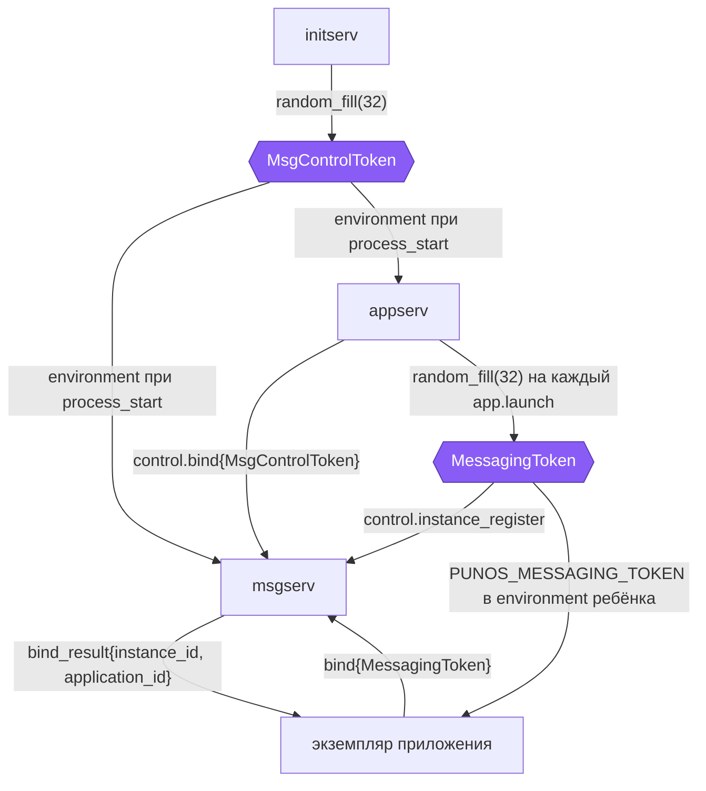
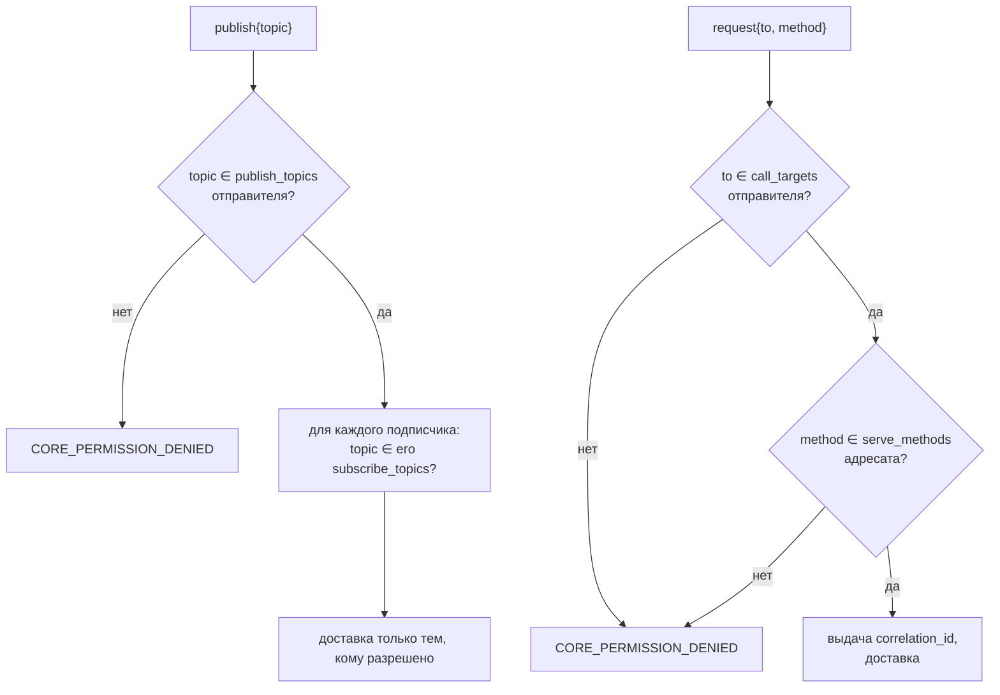

# Опознание отправителя и права

## 1. Задача

Брокер обязан знать, кто прислал кадр. Без этого он не может ни проверить
право на `publish`, ни подставить достоверного отправителя в `event`, ни
убедиться, что `respond` пришёл именно от адресата запроса. Полагаться на
поле «я такой-то» в payload нельзя: приложение заполнит его как угодно.

В PUNos это нерешённая проблема, и спецификация `appserv` называет её прямо:

> В `ipclib` пока нет peer identity, поэтому endpoint `appserv` является
> внутренним API доверенных компонентов, а не публичным endpoint приложения.

Именно поэтому до сих пор ни один сервис не принимает соединения от обычных
приложений на правах «кто угодно»: доверие в v1 декларативное. Брокер не может
позволить себе ту же модель — его клиенты по определению недоверенные.

## 2. Два пути и выбор

### 2.1. `SO_PEERCRED`

Ядро само сообщает PID, UID и GID пира Unix-сокета. Хорошая новость: обёртка
системного вызова уже есть и не захардкожена под один option —
`System/NativeRuntime/SyscallWrappers/include/punos/syscall/syscall.h:57`:

```c
i32 getsockopt(i32 fd, i32 level, i32 option, void *value, socklen_t *length);
```

`ipclib` её уже использует легально — для `SO_ERROR` в
`ipc_connection_finish_connect()` (`System/SpecialLibs/ipclib/src/ipc.c:318`).
Добавить нужно немного: константу `SO_PEERCRED` в `constants.h` (сейчас там
только `SOL_SOCKET`, `SO_REUSEADDR`, `SO_ERROR`) и операцию
`ipc_connection_get_peer_credentials()`.

Но дальше путь обрывается. PID сам по себе бесполезен: нужно отобразить его в
`application_id`, а для этого нужен тот, кто знает соответствие — `appserv`.
А он PID не отдаёт: в `AppStatusResult` его нет, и `libprocess` вообще не
предоставляет API «PID дочернего процесса по `ProcessHandle`» — есть только
`process_current_id()` для своего собственного PID
(`System/SystemLibs/libprocess/include/sys/process.h:80`). Понадобилось бы
расширять и `libprocess`, и `appserv`, и всё равно получить лишь косвенную
привязку.

### 2.2. Токен на экземпляр — выбранный вариант

`appserv` при запуске генерирует `MessagingToken` — 32 случайных байта,
уникальных для экземпляра, — регистрирует пару «токен → (`application_id`,
`instance_id`)» в брокере и передаёт токен ребёнку в environment. Приложение
предъявляет токен при bind и больше ничего о своей личности не сообщает.

Этот вариант выбран не потому, что проще, а потому что **такой механизм в
проекте уже узаконен**. В GUI-слое есть ровно та же задача и ровно то же
решение: `ShellToken` — 32 случайных байта, которые `initserv` создаёт и
передаёт `windowserv` и оболочке, причём

> Передача `ShellToken` требует защищённого handoff через `appserv`, потому что
> shell является пользовательским приложением и не запускается напрямую
> `initserv`.

Приложения в случае брокера — тоже пользовательские, тоже запускаются не
`initserv`, а `appserv`. Задача идентична, значит и машинерию надо брать ту же,
а не изобретать вторую.

`SO_PEERCRED` остаётся как **необязательное усиление** второго уровня: брокер
мог бы сверять PID пира с PID, о котором сообщил `appserv`, чтобы украденный
токен не сработал из чужого процесса. В v1 это не входит — требует расширения
`libprocess` и `appserv`, см. [`upstream-changes.md`](upstream-changes.md#u6).

## 3. Два токена и их роли

| Токен | Кто создаёт | Кто получает | Что разрешает |
| --- | --- | --- | --- |
| `MsgControlToken` | `initserv` при запуске | `msgserv` и `appserv` | `appserv` — открыть control-соединение и вести `InstanceTable` |
| `MessagingToken` | `appserv` на каждый запуск экземпляра | `msgserv` (через control) и сам экземпляр (через environment) | Экземпляру — выполнить bind и получить свою личность |



Пара `initserv` → (`msgserv`, `appserv`) — это в точности схема
`PresenterToken` (displayserv, compositorserv) и `ControllerToken`
(compositorserv, windowserv) из GUI-слоя. Там же зафиксировано правило,
которое брокер обязан соблюдать: **startup-токены живут до завершения
загрузочной сессии, а не до завершения одного процесса**, и при независимом
перезапуске участники пары получают тот же токен. Поэтому перезапуск
`msgserv` не ломает ни control-соединение `appserv`, ни bind приложений — им
достаточно переподключиться с теми же токенами.

## 4. Правила обращения с токенами

1. `MessagingToken` генерируется через `random_fill()` (`sys/random.h`,
   `librandom`) — тот же источник, что у `ShellToken`.
2. Токен уникален для экземпляра, а не для приложения: два экземпляра одного
   `application_id` получают разные токены.
3. Регистрация в брокере выполняется **до** `process_start`. Иначе ребёнок
   успеет выполнить bind раньше, чем брокер узнает его токен, и получит
   `CORE_PERMISSION_DENIED` на ровном месте. Из этого следует требование к
   `appserv`: `instance_id` должен быть назначен до `process_start` — сейчас
   это не так, см. [`upstream-changes.md`](upstream-changes.md#u4).
4. Если регистрация в брокере не удалась, `app.launch` **завершается
   отказом** и процесс не запускается. Приложение без личности в брокере
   бесполезно, а молча запустить его хуже, чем не запустить.
5. Токен не журналируется ни `appserv`, ни `msgserv`, ни при отказе bind — в
   журнал идут `application_id` и `instance_id`, но не байты токена.
6. После успешного bind брокер не хранит токен в структуре клиента: клиент
   хранит уже разрешённую личность.
7. Запись в `InstanceTable` удаляется по `control.instance_release` либо при
   закрытии control-соединения. Обе операции идемпотентны: `PeerClosed`
   клиента и `release` от `appserv` приходят в неопределённом порядке (см.
   [`wire-protocol.md`](wire-protocol.md#63-завершение-экземпляра)).
8. Токен передаётся ребёнку в environment как `PUNOS_MESSAGING_TOKEN` в
   hex-представлении (64 символа ASCII): `environment` в `ProcessLaunch` —
   массив строк, двоичные байты в нём недопустимы.

### Почему environment, а не аргументы и не файл

Аргументы видны в `argv` и попадают в любую диагностику. Файл требует места
на диске, прав и очистки. Environment ребёнка в PUNos не читается никем, кроме
самого ребёнка: процедуры вроде `/proc`-обхода в системе нет, а
`NativeAppSpec.environment` по контракту `appserv` и так остаётся внутренним
полем и не сериализуется клиенту. Это тот же канал, которым GUI-слой передаёт
`ShellToken`.

## 5. Права: статический каталог из PlatformRegistry

Многие-ко-многим без прав означает «любое приложение может слушать и
подделывать что угодно». Права задаются на этапе сборки — ровно так же, как
каталог приложений `NativeAppSpec`, и по той же причине: `PlatformRegistry` —
единственный источник истины, а `PlatformRegistryId` гарантирует, что все
компоненты собраны из одного реестра.

### MessagingLaunchSpec в PlatformRegistry

```json
{
  "platform_registry_id": "punos-registry-1",
  "services": [
    { "id": "msgserv", "path": "/system/bin/msgserv", "enabled": true, "order": 2 }
  ],
  "applications": [
    {
      "application_id": "desktop",
      "display_name": "Desktop",
      "executable": "/system/apps/desktop",
      "messaging": {
        "publish_topics":   ["ui.theme", "ui.locale"],
        "subscribe_topics": ["sensor.gps", "app.state"],
        "serve_methods":    ["open_url"],
        "call_targets":     ["gallery", "settings"]
      }
    },
    {
      "application_id": "gallery",
      "display_name": "Gallery",
      "executable": "/system/apps/gallery",
      "messaging": {
        "publish_topics":   ["app.state"],
        "subscribe_topics": ["ui.theme", "ui.locale"],
        "serve_methods":    ["open_image"],
        "call_targets":     []
      }
    }
  ]
}
```

| Поле | Смысл | Проверяется при |
| --- | --- | --- |
| `publish_topics` | Что приложение вправе публиковать | `publish` |
| `subscribe_topics` | Что вправе получать | `subscribe` |
| `serve_methods` | Какие методы вправе обслуживать | `request` к нему |
| `call_targets` | Каким `application_id` вправе отправлять запросы | `request` от него |

Отсутствие секции `messaging` у приложения означает «не участвует в обмене»:
его bind завершится `CORE_PERMISSION_DENIED`. Пустые списки — приложение
подключается, но ничего не может; это допустимое промежуточное состояние.

### Проверки прав при операциях



Два момента, которые легко упустить:

**Подписка проверяется дважды** — при `subscribe` и при доставке. Второй раз
избыточен в v1, потому что каталог неизменен, но он делает отказ локальным: при
будущих динамических правах не придётся перебирать и чистить подписки.

**`publish` в topic, где у подписчика нет права получать**, не является
ошибкой издателя. Такой подписчик просто не попадает в рассылку и не
учитывается ни в `delivered_count`, ни в `dropped_count`. Издатель не должен
узнавать состав подписчиков и их права — иначе брокер станет каналом утечки
информации о других приложениях.

### Генерация при сборке

Генератор повторяет существующий `tools/generate_catalog.py` из `appserv` и
`initserv`:

| Вход | Выход | Проверки |
| --- | --- | --- |
| `config/platform_registry.json` | общий заголовок с `MessagingSpec[]` и `PlatformRegistryId` | Уникальность `application_id`; каждый `call_targets` существует в реестре; каждый topic и метод — валидный UTF-8 в пределах лимитов; `serve_methods` уникальны внутри приложения; соблюдены `MSG_TOPICS_MAX` и `MSG_SUBSCRIPTIONS_MAX_PER_CLIENT` |

Любое нарушение — **ошибка сборки**, а не предупреждение: по спецификации
`appserv` «несовпадение с PlatformRegistry является ошибкой сборки; ошибочный
встроенный каталог не запускает сервис». Брокер обязан вести себя так же.

## 6. Что эта модель не защищает

Честный список, чтобы его не пришлось обнаруживать на практике:

- **Приложение с доступом к своему environment** может передать токен кому
  угодно внутри системы. В v1 это не считается атакой: приложения из каталога
  доверенные, каталог статический, установки приложений не существует.
- **`ipc_server_create()` по-прежнему делает безусловный `unlink()`** чужого
  endpoint'а (контракт 8 `ipclib`). Приложение, слинковавшее `ipclib`
  напрямую, может занять `/run/punos/msgserv.sock` и притворяться брокером для
  тех, кто подключится позже. Брокер эту дыру не создаёт и не закрывает, она
  общесистемная — см. [`upstream-changes.md`](upstream-changes.md#u7).
- **Права на уровне `application_id`, а не экземпляра.** Два экземпляра одного
  приложения имеют одинаковые права; разделить их v1 не умеет.
- **Нет квот по частоте.** Приложение может публиковать в цикле; защищают
  только ограниченные очереди, но конкурировать за поток брокера оно будет.
