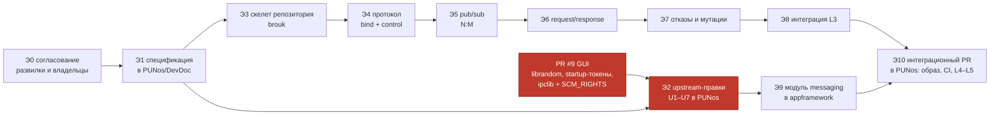

# Порядок работ

## 1. Главное ограничение

Правило проекта: документация в `DevDoc/` является контрактом, реализация
обязана ему соответствовать. Отсюда следует порядок, который нельзя обойти:
**сначала согласованная спецификация, потом код** — и для самого брокера, и
для правок в чужих компонентах.

Второе ограничение — PR #9 «Базовый графический стек» (+22 819 / −505 в 118
файлах, открыт на 28 октября 2026 года). Он меняет `ipclib`, `appserv`,
`initserv` и добавляет `librandom` с `random_fill()`, **без которого токены
сгенерировать нечем**. В ветке `main` этой библиотеки нет. Поэтому код брокера
начинается только после мержа PR #9 либо пишется поверх его ветки.



Красным — то, что не контролируется этим репозиторием: мерж чужого PR и
правки в чужих компонентах. Всё остальное можно делать независимо.

## 2. Структура репозитория

`brouk` — отдельный репозиторий по образцу `appserv`, `initserv` и `logserv`:
код модуля свой, подмножество исходников PUNos вложено снапшотом, ревизия
закреплена, CI не требует доступа к приватному upstream.

```text
.
├── README.md
├── docs/                      # спецификация и проектные решения (сейчас — весь репозиторий)
├── punos.ref                  # закреплённая ревизия PUNos
├── Makefile                   # make setup / all / check
├── service.mk                 # общие правила сборки сервиса
├── include/msgserv.h          # внутренние типы сервиса
├── src/
│   ├── main.c                 # event loop, endpoint, жизненный цикл
│   ├── wire.h                 # кодирование и разбор payload
│   ├── clients.c              # ClientTable, bind, подписки
│   ├── routing.c              # TopicTable, fan-out, очереди получателей
│   ├── pending.c              # PendingTable, correlation_id, дедлайны
│   ├── control.c              # control-соединение appserv, InstanceTable
│   └── logger.c               # клиент logserv
├── config/
│   └── platform_registry.json # вход генератора прав
├── tools/
│   ├── fetch_punos.py         # получение снапшота
│   └── generate_messaging.py  # MessagingSpec[] + PlatformRegistryId
├── tests/                     # L1–L3, фейки, мутации
│   ├── fakes.c / fakes.h
│   ├── fake_peer.h
│   ├── *_runtime.c
│   ├── integration.py
│   └── check_mutations.py
├── vendor/PUNos/              # неизменённое подмножество исходников PUNos
└── .github/workflows/ci.yml
```

Спецификация **дублируется в PUNos**: как у `logserv` («Specification:
`DevDoc/SystemServices/base/logserv.md`») и `initserv`, контракт живёт в
`PUNos/DevDoc`, а код — в своём репозитории. Поэтому
[`docs/msgserv.md`](msgserv.md) на этапе Э1 переносится в
`PUNos/DevDoc/SystemServices/base/msgserv.md` отдельным PR, и дальше PUNos —
источник истины для контракта, а этот репозиторий хранит реализацию и
проектные решения.

## 3. Этапы

### Э0. Согласование развилок

Без кода. Нужны решения, которые принадлежат не автору брокера:

| Развилка | Кто решает | Варианты |
| --- | --- | --- |
| Фатален ли отказ `msgserv` при загрузке | владелец `initserv` | Фатален, как `logserv` / не фатален, приложения получают `CORE_UNSUPPORTED` (предложение — второе) |
| Отказ `app.launch`, если регистрация в брокере не удалась | владелец `appserv` | Отказать / запустить без обмена (предложение — отказать, см. [U1](upstream-changes.md#u1)) |
| Привязка экземпляра к создавшему соединению | владелец `appserv` | Внести в v1 / отложить (предложение — внести: брокер раздаёт `instance_id` всем подписчикам, см. [U4](upstream-changes.md#u4)) |
| Включать ли секцию `messaging` в `PlatformRegistryId` | владельцы `appserv` и `initserv` вместе | Включать только после обновления **обоих** генераторов одним коммитом ([U7](upstream-changes.md#u7)) |

**Готово, когда** по каждой развилке есть письменное решение в issue или в
этом репозитории.

### Э1. Спецификация в PUNos/DevDoc

PR в PUNos, только документация:
`DevDoc/SystemServices/base/msgserv.md`, запись в
`DevDoc/SystemServices/_ServList.md`, правка
`DevDoc/ApplicationLayer/appframework.md` (модуль `messaging`) и
`DevDoc/SpecialLibs/ipclib.md` (если принято [U10](upstream-changes.md#u10)).

**Готово, когда** PR влит и спецификация стала контрактом.

### Э2. Upstream-правки в PUNos

Только после мержа PR #9. Отдельными PR, в этом порядке — каждый следующий
опирается на предыдущий:

1. [U7](upstream-changes.md#u7) — схема `PlatformRegistry` и **оба** генератора
   одним коммитом. Первым, потому что без согласованного `PlatformRegistryId`
   не запустится ни один сервис.
2. [U5](upstream-changes.md#u5) — `initserv`: `MsgControlToken`, регистрация
   `msgserv`, порядок запуска, readiness.
3. [U2](upstream-changes.md#u2) + [U1](upstream-changes.md#u1) +
   [U3](upstream-changes.md#u3) — `appserv`: `instance_id` до
   `process_start`, генерация токена, control-клиент, release.
4. [U9](upstream-changes.md#u9) и [U4](upstream-changes.md#u4) — исправления
   существующих дефектов (по решению из Э0).

**Готово, когда** `appserv` в PUNos умеет зарегистрировать экземпляр в брокере
и передать токен ребёнку, а `initserv` запускает `msgserv` в правильном
порядке. Проверяется заглушкой брокера, которая только принимает bind.

### Э3. Скелет репозитория

`Makefile`, `service.mk`, `punos.ref`, `tools/fetch_punos.py`,
`vendor/PUNos`, CI, генератор `generate_messaging.py`, `main.c` с жизненным
циклом `Starting → Ready → Stopping` без единого сообщения протокола.

**Готово, когда** `make check` проходит на чистом Linux x86_64 без сети, а
линковщик подтверждает отсутствие неразрешённых символов и ELF-интерпретатора.
Тесты: MSG-L1-01, MSG-L3-01…03, MSG-L3-14.

Этап не зависит от Э2: пока правок нет, брокер собирается против старого
снапшота и просто ни от кого не получает регистраций.

### Э4. Протокол: bind и control

`wire.h`, `clients.c`, `control.c`. Разбор и кодирование всех 21 типа, но
обслуживаются только 1–2 и 16–21.

**Готово, когда** проходят MSG-L1-02…06, MSG-L1-33…35 и весь L2 (включая
20 000 мутаций кадров). Это самый важный этап для безопасности: именно здесь
закрепляется, что личность берётся только из токена (MSG-L2-15).

### Э5. Публикация и подписка — собственно N:M

`routing.c`: `TopicTable`, fan-out, очереди получателей, `sequence`,
проверки прав при подписке и при доставке.

**Готово, когда** проходят MSG-L1-07…19 и MSG-L1-40…44. Это первая точка, где
брокер приносит пользу: два приложения обмениваются событиями.

### Э6. Запрос и ответ

`pending.c`: `correlation_id`, `PendingTable`, дедлайны на таймере,
адресация по `instance_id` и по `application_id`.

**Готово, когда** проходят MSG-L1-20…31.

### Э7. Отказы, остановка, мутации

Полная инъекция отказов, корректная остановка по `SIGTERM`,
`tests/check_mutations.py`.

**Готово, когда** проходят MSG-L1-36, MSG-L1-45…47 и **каждая** мутация из
таблицы замечена хотя бы одним тестом (ошибка сборки не считается).

### Э8. Интеграция L3

`tests/integration.py`: настоящие процессы, настоящий `logserv`, медленные и
убитые клиенты, полный fan-out, перезапуск брокера.

**Готово, когда** проходит весь L3, в том числе MSG-L3-12 — журнал не
содержит ни токенов, ни payload приложений.

### Э9. Модуль `messaging` в appframework

PR в PUNos ([U6](upstream-changes.md#u6)). Зависит от Э2, но **не** зависит
от Э4–Э8: фреймворк можно разрабатывать против заглушки брокера, а затем
против настоящего.

**Готово, когда** проходят MSG-L4-01…15, в первую очередь MSG-L4-11 — событие,
пришедшее между запросом и ответом, не путается с ответом.

### Э10. Интеграционный PR в PUNos

Сборка `msgserv` в составе системы, включение в initramfs с сохранением
воспроизводимости, `/init-smoke` с проверкой брокера, шаги CI, запись в
`_ServList.md` ([U8](upstream-changes.md#u8)).

**Готово, когда** проходят MSG-L5-01…04 и обычная загрузка в QEMU печатает
готовность `msgserv` до запуска `appserv`.

## 4. Что можно делать параллельно

| Параллельно | Условие |
| --- | --- |
| Э1 и Э3 | Скелет не зависит от текста спецификации в PUNos |
| Э3 и Э2 | Брокер собирается против старого снапшота |
| Э9 и Э4–Э8 | Фреймворк разрабатывается против заглушки брокера |
| Э5 и Э6 | Разные файлы (`routing.c` и `pending.c`), общая только `ClientTable` |

Строго последовательны: Э0 → Э1, Э4 → Э5, PR #9 → Э2, Э2 → Э9, Э8 + Э9 → Э10.

## 5. Риски

| Риск | Вероятность | Что делать |
| --- | --- | --- |
| Конфликт с PR #9 в `ipclib`, `appserv`, `initserv` | Высокая | Не начинать Э2 до мержа; спецификацию писать сразу |
| Расхождение `PlatformRegistryId` между генераторами | Высокая, последствия тяжёлые (не грузится ни один сервис) | U7 первым PR, оба генератора в одном коммите, тест на совпадение идентификаторов |
| Гонка «ребёнок сделал bind раньше регистрации» | Средняя | U2: `instance_id` до `process_start`, регистрация до запуска; тест MSG-L1-03 |
| Отказ `app.launch` из-за недоступного брокера ломает загрузку оболочки | Средняя | Решение Э0 о фатальности; при «не фатален» — брокер необязателен |
| Медленный подписчик тормозит брокера | Средняя | Собственные очереди мягче `ipclib`; тесты MSG-L3-06, MSG-L3-07 |
| Незапрошенный кадр принимается за ответ на свой запрос | Высокая (типовая ошибка реализации) | Раздельные callback'и и handler'ы; тест MSG-L4-11 |
| `instance_id` из событий используется для остановки чужих приложений | Высокая, если U4 отложат | Решение Э0; до него — не включать `sender_instance_id` в `event` |

Последний риск стоит подчеркнуть: если [U4](upstream-changes.md#u4) решат
отложить, брокер **не должен** раздавать `sender_instance_id` в событиях,
иначе любое приложение сможет гасить любое другое через `appserv`. В этом
случае адресация запросов останется только по `application_id` с ограничением
«ровно один экземпляр».

## 6. После v1

| Что | Зачем | Чего требует |
| --- | --- | --- |
| Launch-on-demand | Доставка приложению, которое не запущено — поведение, близкое к Android intents | `msgserv` становится клиентом `appserv`; отложенная доставка с дедлайном; защита от цикла `msgserv → appserv → приложение → msgserv` |
| Передача дескрипторов | Крупные данные без копирования и без предела 64 КиБ | `SCM_RIGHTS` в `ipclib` (есть в ветке GUI); модель владения fd |
| Права на уровне экземпляра | Разделить два экземпляра одного приложения | Расширение `MessagingSpec` и `InstanceTable` |
| `SO_PEERCRED` | Украденный токен не работает из чужого процесса | [U10](upstream-changes.md#u10): константа, API `ipclib`, PID из `libprocess` |
| Wildcard-topic'и | Удобство подписки на семейство событий | Пересмотр проверки прав и `TopicTable` |
| Опрос состава topic'а | Диагностика и обнаружение | Отдельная модель прав: сейчас это утечка информации о других приложениях |
| Квоты по частоте | Приложение не может занять поток брокера публикацией в цикле | Счётчики в окне времени, политика отказа |
| Durable-очередь | Доставка после перезапуска брокера | Свой формат файла, ротация; `logserv` v1 тоже не даёт durability — делать вместе с ним |
