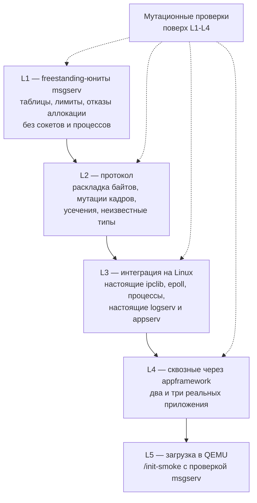

# Набор тестов

## 1. Принципы, взятые из репозитория

Тесты брокера обязаны выглядеть так же, как существующие тесты PUNos, иначе их
нельзя будет встроить в текущий CI.

| Принцип | Как это сделано в PUNos |
| --- | --- |
| Freestanding-юниты без libc | `System/SystemLibs/testing/check.h`: `EXPECT(N, condition)`, каждая проверка имеет уникальный номер, первая упавшая печатает `"<test> runtime test failed: check N"` и завершает процесс со статусом `N` — отказ опознаётся по `echo $?` и в консоли QEMU |
| Инъекция отказов через линковщик | `TEST_LDFLAGS := -Wl,--wrap=memory_allocate -Wl,--wrap=ipc_connection_send …` и `TEST_FAKES := fault_fake`; продакшен-артефакт никогда не линкуется с обёртками |
| Имена тестовых программ | `RUNTIME_TESTS := lifecycle_runtime create_runtime run_runtime fault_runtime …` — суффикс `_runtime` |
| Интеграция на хосте | Python-скрипт (`tests/system/host_integration.py`, `tests/integration.py`) поднимает настоящие процессы сервисов |
| Мутационные проверки | `tests/check_mutations.py`: каждая мутация ломает одно правило спецификации, и тесты **обязаны** это заметить; «ошибка сборки не считается» — тест должен запуститься и упасть |
| Повторные прогоны | В CI отдельные шаги «Repeat thread, sync and signal tests» и «Repeat Application Layer tests» — для отлова недетерминированности |

Правило, которое стоит соблюсти особенно строго: **на каждый контракт
спецификации — хотя бы один тест**. В конце документа — таблица соответствия.

## 2. Уровни



## 3. L1 — freestanding-юниты

Программы: `tables_runtime`, `queue_runtime`, `routing_runtime`,
`pending_runtime`, `fault_runtime`. Ни сокетов, ни процессов: вместо `ipclib`
— fake-пир по образцу `System/ApplicationLayer/appframework/tests/fake_peer.h`.

| ID | Проверка | Ожидание |
| --- | --- | --- |
| MSG-L1-01 | Каталог прав: уникальность `application_id`, валидный UTF-8 topic'ов, лимиты | Некорректный каталог не доводит сервис до создания endpoint'а |
| MSG-L1-02 | Bind с валидным токеном | `CORE_OK`, личность совпадает с зарегистрированной |
| MSG-L1-03 | Bind с неизвестным токеном | `CORE_PERMISSION_DENIED`, соединение закрыто |
| MSG-L1-04 | Bind повторный на том же соединении | `CORE_INVALID_STATE`, соединение **не** закрыто |
| MSG-L1-05 | Операция до bind | `CORE_INVALID_STATE` |
| MSG-L1-06 | `MSG_BIND_TIMEOUT_MS` истёк в `Unbound` | Соединение закрыто без ответа |
| MSG-L1-07 | `subscribe` на разрешённый topic, затем повторно | `CORE_OK`, затем `CORE_ALREADY_EXISTS` |
| MSG-L1-08 | `subscribe` на topic вне `subscribe_topics` | `CORE_PERMISSION_DENIED` |
| MSG-L1-09 | `MSG_SUBSCRIPTIONS_MAX_PER_CLIENT` + 1 | `CORE_OVERFLOW` |
| MSG-L1-10 | `MSG_TOPICS_MAX` + 1 различных topic'ов | `CORE_OVERFLOW` |
| MSG-L1-11 | `MSG_SUBSCRIBERS_MAX_PER_TOPIC` + 1 подписчиков | `CORE_OVERFLOW` последнему |
| MSG-L1-12 | `publish` без подписчиков | `CORE_OK`, `delivered` = 0, `dropped` = 0 |
| MSG-L1-13 | `publish` трём подписчикам | Три кадра в трёх очередях, `delivered` = 3 |
| MSG-L1-14 | `publish` подписчику без права на получение | Не доставлено и **не** учтено ни в `delivered`, ни в `dropped` |
| MSG-L1-15 | `publish` в topic вне `publish_topics` | `CORE_PERMISSION_DENIED` |
| MSG-L1-16 | Очередь получателя: `MSG_QUEUE_MAX_RECORDS` достигнут | Кадр отброшен, `dropped` = 1, остальные получатели не затронуты |
| MSG-L1-17 | Очередь получателя: `MSG_QUEUE_MAX_BYTES` достигнут раньше числа записей | Тот же результат, отказ по байтам |
| MSG-L1-18 | `sequence` после отбрасывания | Увеличился: получатель видит разрыв |
| MSG-L1-19 | `sequence` монотонен и начинается с 1 для каждой пары (получатель, topic) | Нет пропусков при отсутствии отбрасываний |
| MSG-L1-20 | `request` → `respond` | `deliver_response` с `error` = `CORE_OK` и `status` приложения |
| MSG-L1-21 | `request` по `application_id` при двух bind'нутых экземплярах | `CORE_ALREADY_EXISTS` |
| MSG-L1-22 | `request` по `application_id` при нуле экземпляров | `CORE_NOT_FOUND` |
| MSG-L1-23 | `request` к адресату без права обслуживать метод | `CORE_PERMISSION_DENIED` |
| MSG-L1-24 | `request` адресату вне `call_targets` | `CORE_PERMISSION_DENIED` |
| MSG-L1-25 | `respond` с чужим `correlation_id` | `CORE_NOT_FOUND`, никому не доставлено |
| MSG-L1-26 | `respond` дважды на один `correlation_id` | Второй — `CORE_NOT_FOUND` |
| MSG-L1-27 | `MSG_PENDING_MAX_PER_CLIENT` + 1 | `CORE_WOULD_BLOCK` |
| MSG-L1-28 | `MSG_PENDING_MAX_TOTAL` + 1 суммой клиентов | `CORE_WOULD_BLOCK` |
| MSG-L1-29 | Дедлайн запроса истёк | Ровно один `deliver_response` с `CORE_TIMEOUT` |
| MSG-L1-30 | Отключение адресата с открытым запросом | Отправитель получает `CORE_NOT_FOUND` |
| MSG-L1-31 | Отключение отправителя с открытым запросом | Ответ адресата отбрасывается, утечки `Pending` нет |
| MSG-L1-32 | Закрытие соединения | Подписки сняты, очередь освобождена, pending в обе стороны отменены |
| MSG-L1-33 | `control.instance_release` для уже снятого экземпляра | `CORE_OK` (идемпотентность) |
| MSG-L1-34 | Закрытие control-соединения | Вся `InstanceTable` очищена |
| MSG-L1-35 | Второй `control.bind` | `CORE_ALREADY_EXISTS` |
| MSG-L1-36 | `Stopping` при открытых запросах | Каждому — `deliver_response` с `CORE_INVALID_STATE` |

### Инъекция отказов (`fault_runtime`)

Через `-Wl,--wrap=`: `memory_allocate`, `memory_reallocate`, `memory_free`,
`ipc_connection_send`, `ipc_connection_receive`, `ipc_connection_flush`,
`eventloop_wait`, `random_fill`.

| ID | Отказ | Ожидание |
| --- | --- | --- |
| MSG-L1-40 | `memory_allocate` отказывает на постановке в очередь | `CORE_OUT_OF_MEMORY`, сервис жив, прочие получатели обслужены |
| MSG-L1-41 | `memory_allocate` отказывает на `accept` | Соединение закрыто, сервис жив |
| MSG-L1-42 | `memory_allocate` отказывает на `Pending` | `CORE_OUT_OF_MEMORY`, запрос адресату **не** доставлен |
| MSG-L1-43 | `ipc_connection_send` возвращает `CORE_WOULD_BLOCK` | Кадр остаётся в своей очереди, отправка повторяется по `EVENT_WRITABLE`, порядок сохранён |
| MSG-L1-44 | `ipc_connection_send` возвращает жёсткую ошибку | Клиент отключён, подписки сняты, остальные не затронуты |
| MSG-L1-45 | `eventloop_wait` возвращает `CORE_INTERRUPTED` | Цикл продолжается, дедлайны не пропущены |
| MSG-L1-46 | `eventloop_wait` возвращает жёсткую ошибку | Состояние `Failed`, выход с кодом 1 |
| MSG-L1-47 | Утечки: каждый `ipc_message_destroy` вызван ровно один раз | Счётчик выделений обнуляется к завершению |

## 4. L2 — протокол

Программа `wire_runtime` плюс генератор мутаций кадров по образцу
`ReaderMutationTest` из Gon-On (там 15 000 детерминированных порч файла —
подход переносится на кадры).

| ID | Проверка | Ожидание |
| --- | --- | --- |
| MSG-L2-01 | Эталонная раскладка каждого из 21 типа сообщений: байты сверяются вручную, без парсера сервиса | Побайтовое совпадение |
| MSG-L2-02 | `protocol_version` ≠ 1 | `CORE_UNSUPPORTED` |
| MSG-L2-03 | `payload_size` меньше раскладки (усечение) на каждом поле каждого типа | `CORE_INVALID_ARGUMENT`, без чтения за буфером |
| MSG-L2-04 | `payload_size` больше раскладки (лишние байты) | `CORE_INVALID_ARGUMENT` |
| MSG-L2-05 | `String.length` больше остатка payload | `CORE_INVALID_ARGUMENT` |
| MSG-L2-06 | Невалидный UTF-8 в topic, методе, `application_id` | `CORE_INVALID_ARGUMENT` |
| MSG-L2-07 | `NUL` внутри строки | `CORE_INVALID_ARGUMENT` |
| MSG-L2-08 | `reserved` ≠ 0 в `RequestEnvelope` | `CORE_INVALID_ARGUMENT` |
| MSG-L2-09 | `address_kind` = 0 с непустым `application_id` и наоборот | `CORE_INVALID_ARGUMENT` |
| MSG-L2-10 | Неизвестный `message_type` | Журнал `ERROR`, соединение закрыто, ответа нет |
| MSG-L2-11 | Клиент присылает тип «сервис → клиент» (`event`, `deliver_request`, `deliver_response`) | Журнал `ERROR`, соединение закрыто |
| MSG-L2-12 | Payload ровно `MSG_PAYLOAD_MAX_SIZE` и на байт больше | `CORE_OK`, затем `CORE_OVERFLOW` |
| MSG-L2-13 | Topic ровно `MSG_TOPIC_MAX_LENGTH` и на байт длиннее | `CORE_OK`, затем `CORE_OVERFLOW` |
| MSG-L2-14 | 20 000 детерминированных порч корректных кадров | Либо корректный отказ, либо корректная обработка; ни одного выхода за буфер и ни одного падения |
| MSG-L2-15 | Поля отправителя в `event` при попытке их подделать | Заполнены сервисом, присланное клиентом игнорируется |

MSG-L2-15 стоит отдельно: это не проверка формата, а проверка того, что
личность не берётся из payload. Контракт 3 спецификации.

## 5. L3 — интеграция на Linux

Python-скрипт `tests/integration.py` по образцу `appserv`: настоящие
процессы, настоящий `ipclib`, настоящие `epoll` и `timerfd`, настоящий
`logserv`, приватные временные endpoint'ы, вкомпилированные в отдельные
тестовые бинарники (продакшен-endpoint остаётся `/run/punos/msgserv.sock`).

| ID | Проверка | Ожидание |
| --- | --- | --- |
| MSG-L3-01 | Endpoint создаётся последним шагом инициализации | До готовности каталога файла сокета нет |
| MSG-L3-02 | Отсутствует `MsgControlToken` | Выход с `PROCESS_EXIT_INITIALIZATION_FAILED` (3), endpoint не создан |
| MSG-L3-03 | Некорректный встроенный каталог прав | Выход 3, endpoint не создан |
| MSG-L3-04 | Пять одновременных клиентов, перекрёстные подписки | Каждое событие получают ровно те, кому положено |
| MSG-L3-05 | `MSG_CLIENTS_MAX` + 1 подключений | Последнее отклонено, существующие работают |
| MSG-L3-06 | Клиент не читает свой сокет, пока очередь ядра и `ipclib` не заполнятся | Брокер не блокируется, остальные клиенты обслуживаются с прежней задержкой |
| MSG-L3-07 | Издатель отправляет 10 000 событий подряд | Ни одной блокировки, отброшенные события учтены, `sequence` показывает разрывы |
| MSG-L3-08 | Полный fan-out: 64 КиБ × 64 подписчика | Укладывается в очередь `ipclib`, отказов по транспорту нет |
| MSG-L3-09 | Клиент убит `SIGKILL` | `PeerClosed`, подписки сняты, pending отменены |
| MSG-L3-10 | `SIGTERM` брокеру | Корректный выход 0, pending закрыты `CORE_INVALID_STATE`, endpoint удалён |
| MSG-L3-11 | Перезапуск брокера, повторный bind тем же токеном | `CORE_OK`; подписки нужно оформлять заново |
| MSG-L3-12 | Настоящий `logserv`: отказы и отбрасывания в журнале | Записи есть, **payload приложения в них отсутствует** (контракт 15) |
| MSG-L3-13 | `logserv` недоступен | Брокер работает, диагностика отложена, не теряется |
| MSG-L3-14 | Линковка | Нет неразрешённых символов и нет ELF-интерпретатора |

MSG-L3-12 — проверка, которую легко забыть и дорого обнаружить: тест обязан
grep'ать файл журнала на известный маркер payload и требовать его отсутствия.

## 6. L4 — сквозные через appframework

Уровень, который существует сейчас как «appframework with real logserv and
appserv», расширяется до «with real logserv, appserv and msgserv».

| ID | Сценарий | Ожидание |
| --- | --- | --- |
| MSG-L4-01 | Приложение A публикует, B и C получают | Оба handler'а вызваны с корректными `sender` и payload |
| MSG-L4-02 | A запрашивает B, B отвечает из handler'а | `AppMsgResponseCallback` с `CORE_OK` и `status` приложения |
| MSG-L4-03 | B отвечает **позже**, из таймера | Ответ доходит, корреляция сохранена |
| MSG-L4-04 | `AppMsgRequestHandler` не установлен | Фреймворк сам отвечает `CORE_UNSUPPORTED`, отправитель не ждёт дедлайна |
| MSG-L4-05 | Запуск без `PUNOS_MESSAGING_TOKEN` | Все `app_msg_*` → `CORE_UNSUPPORTED`, приложение работает |
| MSG-L4-06 | `app_msg_*` до завершения bind | Принято и отправлено после bind |
| MSG-L4-07 | Брокер перезапущен под работающим приложением | `AppMsgLinkHandler(false)`, затем `(true)`, подписки восстановлены фреймворком |
| MSG-L4-08 | Pending-запросы при разрыве | Callback'и с `CORE_INVALID_STATE`, фреймворк их не повторяет |
| MSG-L4-09 | `app_destroy()` при открытых запросах | Все callback'и вызваны с `CORE_INVALID_STATE`, `flush` до `close` |
| MSG-L4-10 | Порядок callback'ов запросов | Строго в порядке запросов |
| MSG-L4-11 | `event` приходит между запросом и ответом на него | Оба доставлены, перепутывания нет |
| MSG-L4-12 | Владение памятью: payload события после выхода из handler'а | Освобождён фреймворком; тест с ASan-сборкой на хосте |
| MSG-L4-13 | Три приложения, N:M: два издателя, три подписчика, два topic'а | Матрица доставки совпадает с правами из реестра |
| MSG-L4-14 | `app_msg_identity()` | Совпадает с `instance_id` из `app.launch_result`, полученного запускающей стороной |
| MSG-L4-15 | Вызов `app_msg_*` не с потока-владельца | `CORE_INVALID_STATE` |

MSG-L4-11 — ключевой тест нового режима: он ловит самую вероятную ошибку
реализации, когда входящий незапрошенный кадр принимают за ответ на свой
запрос.

## 7. L5 — загрузка в QEMU

Расширение `/init-smoke` и `System/Boot/ServicesProbe`.

| ID | Проверка | Ожидание |
| --- | --- | --- |
| MSG-L5-01 | Обычная загрузка | В консоли готовность `msgserv` **до** запуска `appserv` |
| MSG-L5-02 | `/init-smoke`: bind контрольным токеном, публикация, приём вторым соединением | Событие доставлено внутри образа |
| MSG-L5-03 | Воспроизводимость initramfs с `msgserv` | Две сборки совпадают побайтово |
| MSG-L5-04 | `msgserv` отсутствует или падает при старте | Система всё равно грузится, приложения получают `CORE_UNSUPPORTED` (зависит от решения по [U5](upstream-changes.md#u5)) |

## 8. Мутационные проверки

Файл `tests/check_mutations.py`, семантика как в `appframework`: мутация
применяется к одноразовой копии `System/`, ломает **одно** правило
спецификации, и тесты обязаны это заметить — ненулевой выход `make check`,
причём тестовая программа должна запуститься и упасть; **ошибка сборки не
считается замеченной мутацией**.

| Мутация | Какое правило ломает | Какой тест обязан упасть |
| --- | --- | --- |
| Личность берётся из payload, а не из таблицы bind | Контракт 3 | MSG-L2-15 |
| `sequence` не увеличивается при отбрасывании | Контракт 9 | MSG-L1-18 |
| Проверка прав на `publish` убрана | Контракт 5 | MSG-L1-15 |
| Проверка прав при доставке убрана | Контракт 5 | MSG-L1-14 |
| Предел очереди получателя снят | Контракт 7 | MSG-L1-16, MSG-L3-06 |
| Переполнение одного получателя прерывает рассылку остальным | Контракт 7 | MSG-L1-16 |
| `Pending` не удаляется при отключении адресата | Контракт 10 | MSG-L1-30 |
| Дедлайны проверяются только когда тик совпал с пустым циклом | Потоковая модель | MSG-L1-29 |
| `respond` не проверяет, что `correlation_id` принадлежит отвечающему | Контракт 11 | MSG-L1-25 |
| Подписки не снимаются при закрытии соединения | Контракт 12 | MSG-L1-32 |
| `ipc_message_destroy` вызывается дважды либо не вызывается | Владение ресурсами | MSG-L1-47 |
| Токен попадает в журнал | Правило 5 модели личности | MSG-L3-12 |
| Payload попадает в журнал | Контракт 15 | MSG-L3-12 |
| Endpoint создаётся до проверки каталога | Контракт 2 | MSG-L3-01, MSG-L3-03 |
| `CORE_OK` на `publish` выдаётся после доставки, а не после постановки в очередь | Контракт 6 | MSG-L3-06 |

## 9. Покрытие контрактов спецификации

| Контракт [`msgserv.md`](msgserv.md#контракты) | Тесты |
| --- | --- |
| 1. Все ошибки — `ErrorCode` | весь L1, L2 |
| 2. Проверки каталога до endpoint'а | MSG-L1-01, MSG-L3-01, MSG-L3-03 |
| 3. Личность только из токена | MSG-L1-02, MSG-L1-03, MSG-L2-15 |
| 4. Токен проверяется один раз, не хранится | MSG-L1-04, MSG-L3-12 |
| 5. Права из `MessagingSpec` | MSG-L1-08, MSG-L1-14, MSG-L1-15, MSG-L1-23, MSG-L1-24 |
| 6. `CORE_OK` = постановка в очередь | MSG-L1-12, MSG-L3-06 |
| 7. Переполнение отбрасывает только своего получателя | MSG-L1-16, MSG-L1-17, MSG-L3-07 |
| 8. Исчерпание pending → `CORE_WOULD_BLOCK` | MSG-L1-27, MSG-L1-28 |
| 9. Монотонный `sequence` | MSG-L1-18, MSG-L1-19 |
| 10. Ровно один `deliver_response` | MSG-L1-20, MSG-L1-29, MSG-L1-30, MSG-L1-36 |
| 11. Чужой `correlation_id` | MSG-L1-25, MSG-L1-26 |
| 12. Закрытие соединения чистит всё | MSG-L1-32, MSG-L3-09 |
| 13. Один поток-владелец | MSG-L4-15 |
| 14. Ни одна операция не блокирует | MSG-L1-43, MSG-L3-06 |
| 15. Payload не журналируется | MSG-L3-12 |
| 16. Корректное завершение по `SIGTERM` | MSG-L3-10 |

## 10. Что намеренно не тестируется в v1

| Не тестируется | Почему |
| --- | --- |
| Durability и доставка после перезапуска | Их нет в контракте: доставка at-most-once, без персистентности |
| Производительность и задержки | Нет требований; ограничения заданы лимитами, а не временем |
| Поведение при `MSG_CLIENTS_MAX` > 64 | Каталог приложений ограничен 64 записями, больше клиентов физически нет |
| Передача дескрипторов | Вне v1; появится вместе с `SCM_RIGHTS` в `ipclib` |
| Подделка PID пира | Вне v1: `SO_PEERCRED` — [U10](upstream-changes.md#u10) |
| Сетевой доступ | `ipclib` по контракту 1 поддерживает только `AF_UNIX` |

## 11. Команды

Этот репозиторий — отдельный модуль со вложенным снапшотом PUNos
(`vendor/PUNos`, ревизия в `punos.ref`), как `appserv`, `initserv` и `logserv`.
Автономная сборка и тесты L1–L3 не требуют доступа к upstream и сети:

```sh
make setup                                  # проверка ревизии снапшота
make all                                    # build/msgserv
make check                                  # L1 + L2 + L3
python3 tests/check_mutations.py            # мутационные проверки
make check PUNOS_DIR=../PUNos               # против внешнего клона PUNos
```

Уровни L4 и L5 выполняются уже в PUNos, после интеграционного PR: сквозные
тесты `appframework` и загрузочный smoke живут в дереве PUNos и доступны
только оттуда.

```sh
# в репозитории PUNos, после интеграции
make -C System/SystemServices check
make -C System/ApplicationLayer/appframework check-system   # L4
./System/scripts/check-qemu-boot.sh                         # L5
```

CI этого репозитория прогоняет L1–L3 на нативном Linux x86_64 runner'е
(`.github/workflows/ci.yml`), повторяя схему трёх существующих сервисов.
