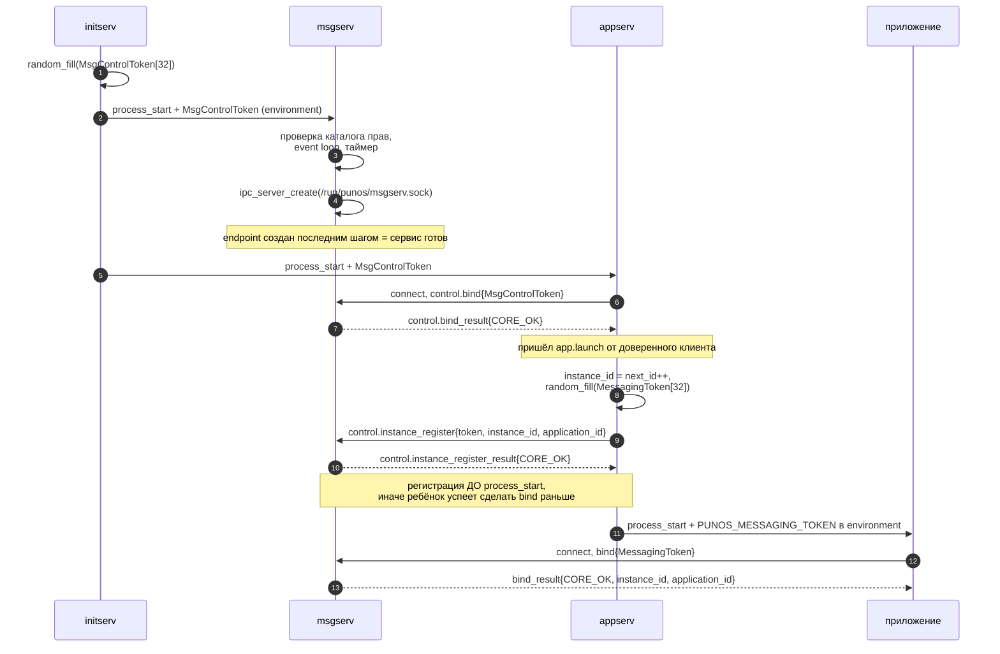
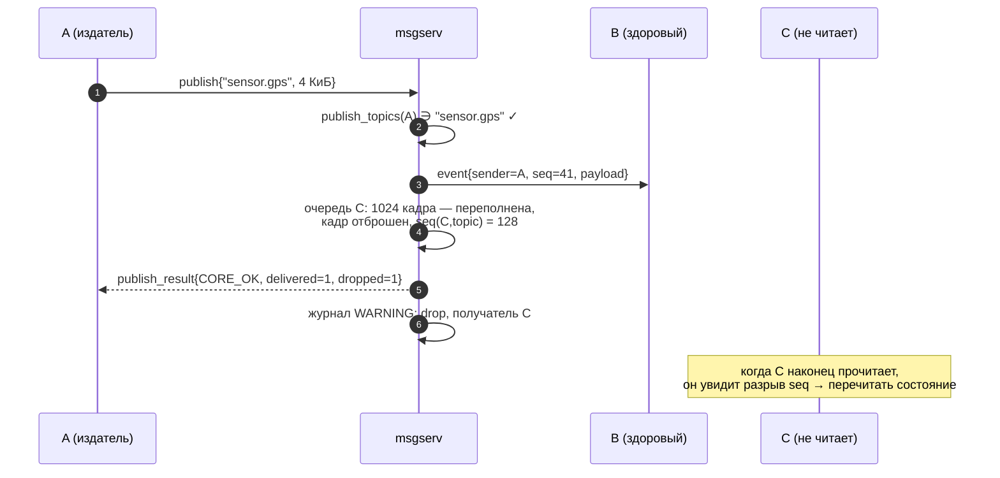
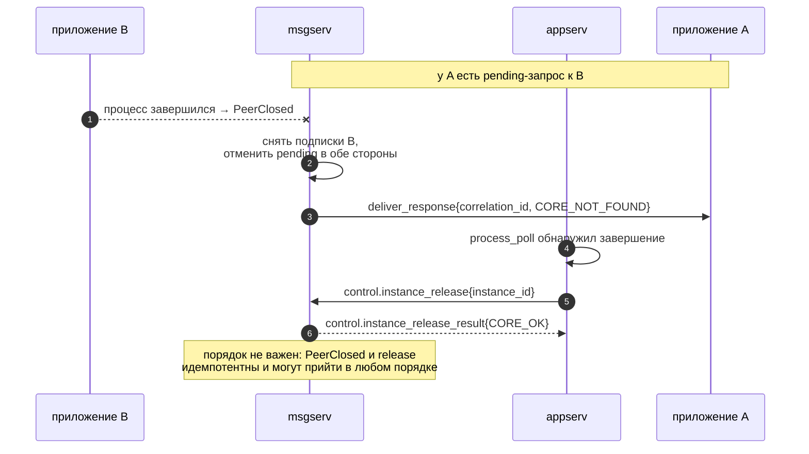
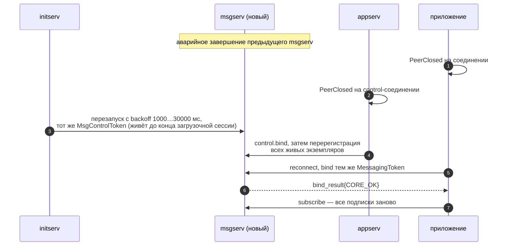

# Протокол msgserv v1

## 1. Общие правила

Каждое сообщение — **один кадр `ipclib`**. Заголовок кадра (8 байт:
`payload_size` u32, `message_type` u32) принадлежит `ipclib` и здесь не
описывается; ниже описан только payload.

| Правило | Значение |
| --- | --- |
| Порядок байтов | little-endian (как в `appserv` и `logserv`) |
| Выравнивание и padding | отсутствуют |
| Строки | UTF-8 по RFC 3629, без внутреннего `NUL`, терминатор не передаётся |
| Версия | первое поле каждого сообщения «клиент → сервис» — `u16 protocol_version` = `MSG_PROTOCOL_VERSION` |
| Неизвестная версия | `CORE_UNSUPPORTED` |
| `ErrorCode` | `u32`, значения `ErrorCode` из `libcore` |

Составные типы:

| Обозначение | Раскладка |
| --- | --- |
| `String` | `u16 length`, затем `u8 bytes[length]` |
| `Blob` | `u32 size`, затем `u8 bytes[size]` |
| `Token` | `u8 bytes[32]`, ровно `MSG_TOKEN_SIZE` |

Пустая `String` (`length` = 0) допустима только там, где это прямо разрешено.
Payload приложения может быть пустым (`size` = 0).

## 2. Таблица типов сообщений

| `message_type` | Имя | Направление | Payload |
| --- | --- | --- | --- |
| 1 | `bind` | клиент → сервис | `BindRequest` |
| 2 | `bind_result` | сервис → клиент | `BindResult` |
| 3 | `subscribe` | клиент → сервис | `TopicRequest` |
| 4 | `subscribe_result` | сервис → клиент | `AckResult` |
| 5 | `unsubscribe` | клиент → сервис | `TopicRequest` |
| 6 | `unsubscribe_result` | сервис → клиент | `AckResult` |
| 7 | `publish` | клиент → сервис | `PublishRequest` |
| 8 | `publish_result` | сервис → клиент | `PublishResult` |
| 9 | `event` | **сервис → клиент, незапрошенное** | `EventNotification` |
| 10 | `request` | клиент → сервис | `RequestEnvelope` |
| 11 | `request_result` | сервис → клиент | `RequestAck` |
| 12 | `deliver_request` | **сервис → клиент, незапрошенное** | `DeliveredRequest` |
| 13 | `respond` | клиент → сервис | `ResponseEnvelope` |
| 14 | `respond_result` | сервис → клиент | `AckResult` |
| 15 | `deliver_response` | **сервис → клиент, незапрошенное** | `DeliveredResponse` |
| 16 | `control.bind` | `appserv` → сервис | `ControlBindRequest` |
| 17 | `control.bind_result` | сервис → `appserv` | `AckResult` |
| 18 | `control.instance_register` | `appserv` → сервис | `InstanceRegisterRequest` |
| 19 | `control.instance_register_result` | сервис → `appserv` | `AckResult` |
| 20 | `control.instance_release` | `appserv` → сервис | `InstanceReleaseRequest` |
| 21 | `control.instance_release_result` | сервис → `appserv` | `AckResult` |

Типы 9, 12 и 15 — то, чего в PUNos ещё не было: сервис присылает кадр, который
клиент не запрашивал. Клиент обязан быть готов получить их в любой момент
после успешного bind, в том числе между своим запросом и ответом на него.

## 3. Раскладка payload

### BindRequest (34 байта)

| Смещение | Поле | Тип | Значение |
| --- | --- | --- | --- |
| 0 | `protocol_version` | `u16` | 1 |
| 2 | `token` | `Token` | `MessagingToken`, выданный `appserv` |

### BindResult

| Поле | Тип | Значение |
| --- | --- | --- |
| `error` | `u32` | `CORE_OK` при успехе |
| `instance_id` | `u64` | Определён только при `CORE_OK`; совпадает с `AppInstanceId` из `appserv` |
| `application_id` | `String` | Определён только при `CORE_OK`; не более `APP_ID_MAX_LENGTH` |

Сервис возвращает клиенту его собственную личность: приложение узнаёт свой
`instance_id`, не доверяя ничему, кроме брокера.

### TopicRequest

| Поле | Тип | Ограничение |
| --- | --- | --- |
| `protocol_version` | `u16` | 1 |
| `topic` | `String` | непустая, не более `MSG_TOPIC_MAX_LENGTH` |

### AckResult

| Поле | Тип |
| --- | --- |
| `error` | `u32` |

### PublishRequest

| Поле | Тип | Ограничение |
| --- | --- | --- |
| `protocol_version` | `u16` | 1 |
| `topic` | `String` | непустая, не более `MSG_TOPIC_MAX_LENGTH` |
| `payload` | `Blob` | не более `MSG_PAYLOAD_MAX_SIZE` |

### PublishResult

| Поле | Тип | Значение |
| --- | --- | --- |
| `error` | `u32` | `CORE_OK`, если публикация принята |
| `delivered_count` | `u16` | Подписчиков, в чьи очереди кадр поставлен |
| `dropped_count` | `u16` | Подписчиков, у которых очередь переполнена |

`delivered_count` = 0 и `dropped_count` = 0 при `CORE_OK` — нормальная
ситуация: у topic'а нет подписчиков. Это **не** ошибка.

### EventNotification

| Поле | Тип | Значение |
| --- | --- | --- |
| `sender_instance_id` | `u64` | Заполняет сервис |
| `sender_application_id` | `String` | Заполняет сервис |
| `topic` | `String` | Topic публикации |
| `sequence` | `u64` | Монотонный для пары (получатель, topic), от 1 |
| `payload` | `Blob` | Непрозрачен для сервиса |

Поля отправителя заполняет **сервис** из личности bind'нутого соединения.
Отправитель не может их подменить — их нет в `PublishRequest`.

Разрыв в `sequence` означает, что события были отброшены по переполнению
очереди. Приложение, которому важна полнота, обязано воспринимать разрыв как
«перечитать состояние целиком», а не как ошибку.

### RequestEnvelope

| Поле | Тип | Ограничение |
| --- | --- | --- |
| `protocol_version` | `u16` | 1 |
| `address_kind` | `u8` | 0 — по `instance_id`, 1 — по `application_id` |
| `reserved` | `u8` | 0; иное значение — `CORE_INVALID_ARGUMENT` |
| `instance_id` | `u64` | ненулевой при `address_kind` = 0, иначе 0 |
| `application_id` | `String` | непустая при `address_kind` = 1, иначе пустая |
| `method` | `String` | непустая, не более `MSG_METHOD_MAX_LENGTH` |
| `payload` | `Blob` | не более `MSG_PAYLOAD_MAX_SIZE` |

Адресация по `application_id` однозначна только когда bind'нут ровно один
экземпляр этого приложения:

| Состояние адресата | Результат |
| --- | --- |
| Ровно один bind'нутый экземпляр | Доставка ему |
| Ни одного | `CORE_NOT_FOUND` |
| Больше одного | `CORE_ALREADY_EXISTS` |

Поэтому надёжный путь — адресация по `instance_id`, который приложение узнаёт
из поля `sender_instance_id` полученного `event`. Это и есть штатный механизм
обнаружения: приложение объявляет о себе публикацией в topic, остальные берут
его `instance_id` оттуда.

### RequestAck

| Поле | Тип | Значение |
| --- | --- | --- |
| `error` | `u32` | `CORE_OK`, если запрос принят и поставлен адресату |
| `correlation_id` | `u64` | Определён только при `CORE_OK`; выдаёт сервис |

`CORE_OK` означает «принят», не «доставлен» и не «обработан». Результат
придёт отдельным `deliver_response`.

### DeliveredRequest

| Поле | Тип | Значение |
| --- | --- | --- |
| `correlation_id` | `u64` | Для ответа |
| `sender_instance_id` | `u64` | Заполняет сервис |
| `sender_application_id` | `String` | Заполняет сервис |
| `method` | `String` | Запрошенный метод |
| `payload` | `Blob` | Непрозрачен для сервиса |

### ResponseEnvelope

| Поле | Тип | Значение |
| --- | --- | --- |
| `protocol_version` | `u16` | 1 |
| `correlation_id` | `u64` | Из полученного `deliver_request` |
| `status` | `u32` | Прикладной `ErrorCode` — результат **приложения**, не транспорта |
| `payload` | `Blob` | не более `MSG_PAYLOAD_MAX_SIZE` |

### DeliveredResponse

| Поле | Тип | Значение |
| --- | --- | --- |
| `correlation_id` | `u64` | Запрос, который закрывается |
| `error` | `u32` | Транспортный результат: `CORE_OK`, `CORE_TIMEOUT`, `CORE_NOT_FOUND`, `CORE_INVALID_STATE` |
| `status` | `u32` | Прикладной результат; определён только при `error` = `CORE_OK` |
| `payload` | `Blob` | Определён только при `error` = `CORE_OK` |

Два кода разделены сознательно: `error` отвечает на вопрос «дошло ли до
адресата и ответил ли он», `status` — «что ответило приложение». Смешивать их
нельзя, иначе отказ транспорта невозможно отличить от отказа логики.

### ControlBindRequest (34 байта)

| Поле | Тип | Значение |
| --- | --- | --- |
| `protocol_version` | `u16` | 1 |
| `control_token` | `Token` | `MsgControlToken` от `initserv` |

### InstanceRegisterRequest

| Поле | Тип | Ограничение |
| --- | --- | --- |
| `protocol_version` | `u16` | 1 |
| `messaging_token` | `Token` | Токен, выданный экземпляру |
| `instance_id` | `u64` | ненулевой `AppInstanceId` |
| `application_id` | `String` | непустая, есть в каталоге `MessagingSpec` |

### InstanceReleaseRequest (10 байт)

| Поле | Тип |
| --- | --- |
| `protocol_version` | `u16` |
| `instance_id` | `u64` |

## 4. Коды ошибок по операциям

| Код | Когда |
| --- | --- |
| `CORE_OK` | Операция принята |
| `CORE_INVALID_ARGUMENT` | Размер payload не соответствует раскладке; нулевой `instance_id`; пустой topic или метод; `reserved` ≠ 0; невалидный UTF-8 |
| `CORE_UNSUPPORTED` | `protocol_version` ≠ 1 |
| `CORE_INVALID_STATE` | Операция не допустима в состоянии соединения; сервис в `Stopping` |
| `CORE_PERMISSION_DENIED` | Неверный токен при bind; topic или метод не разрешён `MessagingSpec` клиента |
| `CORE_NOT_FOUND` | Адресат не bind'нут; неизвестный или чужой `correlation_id`; `unsubscribe` на неподписанный topic |
| `CORE_ALREADY_EXISTS` | `subscribe` на уже подписанный topic; больше одного экземпляра при адресации по `application_id`; второй `control.bind` |
| `CORE_WOULD_BLOCK` | Исчерпан `MSG_PENDING_MAX_PER_CLIENT` или `MSG_PENDING_MAX_TOTAL` |
| `CORE_OVERFLOW` | Превышен `MSG_PAYLOAD_MAX_SIZE`, `MSG_TOPIC_MAX_LENGTH`, `MSG_METHOD_MAX_LENGTH`, `MSG_SUBSCRIPTIONS_MAX_PER_CLIENT`, `MSG_TOPICS_MAX` или `MSG_SUBSCRIBERS_MAX_PER_TOPIC` |
| `CORE_TIMEOUT` | Запрос не получил ответа за `MSG_REQUEST_TIMEOUT_MS` |
| `CORE_OUT_OF_MEMORY` | Отказ `memory_allocate` при постановке в очередь |

## 5. Нарушения протокола

Неизвестный `message_type`, несоответствие `payload_size` раскладке, строка с
невалидным UTF-8 в control-сообщении и сообщение «сервис → клиент»,
присланное клиентом, — это **нарушения протокола, а не ошибки операции**.
Коррелировать ответ в таких случаях не с чем, поэтому сервис журналирует
`ERROR` с `application_id` клиента и закрывает соединение без ответа.

Отдельно: `bind` на уже bind'нутом соединении — `CORE_INVALID_STATE` без
закрытия (повторный bind безвреден и может быть следствием гонки при
переподключении).

## 6. Последовательности обмена

### 6.1. Запуск и регистрация экземпляра

### 6.2. Публикация с переполнением у одного подписчика

### 6.3. Завершение экземпляра

`PeerClosed` и `control.instance_release` принципиально приходят в
неопределённом порядке: соединение рвётся сразу при завершении процесса, а
`appserv` узнаёт о нём только на следующем тике `process_poll` — до 1000 мс
позже. Обе операции обязаны быть идемпотентными.

### 6.4. Перезапуск брокера

Токены переживают перезапуск: по модели GUI-слоя «startup tokens живут до
завершения загрузочной сессии, а не до завершения одного процесса, и при
независимом перезапуске участники пары получают тот же токен». Подписки и
pending-запросы — нет. Переподключение и восстановление подписок делает
`appframework`, приложение этого не видит.
